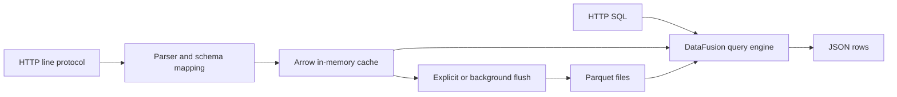

# MynaDB 首发素材包（草稿）

状态：内容草稿，尚未向任何社区发布。功能证据见
[逐项检查记录](2026-11-09-open-source-promotion-checklist.md)。
在许可证、构建、实际试用和独立复测通过前，不把本文当成正式发布公告。

## 一句话介绍

中文：MynaDB 是一个基于 Rust、Arrow、Parquet 和 DataFusion 的时序数据库项目，支持 SQL 查询和 InfluxDB line protocol 写入，仍在持续开发。

English: MynaDB is a time-series database project in Rust, built with Arrow,
Parquet and DataFusion, with SQL queries and InfluxDB line protocol ingestion.
It is still under development.

## 一段话介绍

中文：MynaDB 探索如何用 Rust 与 Arrow 生态处理时序数据：通过 HTTP 接收 line protocol，先在内存中形成批次，再写入 Parquet，并通过 DataFusion 执行 SQL。仓库也包含 WAL、集群和其他遥测接入实现。当前希望先收集本地运行体验、数据模型和查询行为方面的反馈；不同协议和故障场景的验证范围会单独记录。

English: MynaDB explores a Rust and Arrow-based approach to time-series data.
HTTP line protocol writes are buffered in memory and flushed to Parquet, while
DataFusion executes SQL over buffered and stored data. The repository also
contains WAL, cluster and other telemetry ingestion implementations. The initial
feedback request focuses on local setup, the data model and query behavior;
protocol interoperability and failure recovery are documented separately.

## 中文技术文章草稿

# 用 Rust、Arrow、Parquet 和 DataFusion 构建时序数据库：MynaDB 的写入与查询路径

时序数据系统要处理的不只是“接收一行指标”。写入往往是连续的小批次，查询却可能跨越大量历史记录。直接为每个请求生成一个文件，容易积累小文件；只在内存中缓冲，又需要明确说明数据什么时候真正落盘。

MynaDB 是围绕这些问题展开的一个 Rust 时序数据库项目。它使用 Arrow 表达内存批次，使用 Parquet 保存列式数据，并让 DataFusion 执行 SQL。本文介绍目前代码中的单机路径及其边界，不把已有实现等同于经过完整验证的产品能力。

### 从一行协议到一张表

一次本地写入可以从下面的数据开始：

```text
cpu,host=server01 usage=23.5
```

向 `/write/demo` 提交时，URL 选择数据库 `demo`。使用 `service_as_schema` 策略且没有 `service` 标签时，measurement `cpu` 映射到 `default` schema 中的表，完整名称为 `demo.default.cpu`。`host` 是标签，`usage` 是浮点字段。显式时间戳使用纳秒；省略时间戳时使用接入时间。

这套映射减少了写入前建表的步骤，但也引出了需要验证的细节：不同批次出现不同字段时如何对齐 schema？字符串中的空格或逗号怎样解析？无效行是否被跳过？当前解析器存在忽略解析失败行的批处理路径，因此应用不能只根据 HTTP 成功状态推断每一行都被接受。后续兼容性工作需要公开明确的输入和结果。

### 为什么先缓冲，再写 Parquet

写入由 `src/storage/line_protocol.rs` 解析，随后交给缓存和存储路径。缓存将数据聚合为批次，再按配置或手动请求触发 flush。这样做的目的，是在列式文件的读取效率与持续小写入之间建立一个批处理边界。

这个设计并没有消除取舍。更大的批次可能减少小文件，但也提高内存占用，并改变 flush 前后数据的位置。Compaction 可以继续合并文件，却同样需要限制并发和资源使用。吞吐、延迟和内存的关系必须通过可复现的测试说明，不能仅凭设计推导性能倍数。

### SQL 同时面对内存和文件

SQL 从 `/query/:db` 进入，以 URL 中的数据库作为上下文。查询引擎需要发现表，并处理缓存中的批次和已经写入的 Parquet 文件。DataFusion 提供查询执行基础，但表发现、schema 对齐、时间列和结果格式仍然是项目自己的工程工作。

可以从一个很小的查询开始核对行为：

```sql
SELECT host, usage FROM default.cpu ORDER BY host
```

值得检查的不仅是请求有没有返回 200，还包括：行数是否正确、列类型是否一致、flush 前后结果是否相同、重启后已落盘的数据能否再次查询。检查脚本和实际输出会与推广检查记录一起保存。

### Flush 和 WAL 回答不同的问题

为了让试用边界清楚，本地示例显式关闭 WAL。这个示例验证的应是“手动 flush 后重启仍可查询”，而不是“刚刚确认的写入能抵抗进程或机器故障”。启用 WAL 后，还要区分异步写入和 `sync_on_write`，并分别检查恢复结果。

因此，不能把一次正常重启成功描述成已经验证了断电恢复，也不能把使用不同持久化条件的吞吐结果直接比较。WAL、flush 与恢复测试会作为独立主题展开。

### 当前范围和希望得到的反馈

仓库还包含 Prometheus、OTLP、集群、Grafana 和 Iceberg 相关实现。这些实现需要各自的客户端版本、拓扑和故障场景验证。当前最希望得到的反馈，是一个陌生开发者能否按照文档完成启动、写入、SQL 查询、flush 和重启，以及实际结果是否符合说明。

项目仍在开发。根许可证和权属确认、独立试用、协议互操作测试、发行包和性能基线都需要按检查记录逐步完成。欢迎从具体输入、查询结果或运行失败开始提问，而不只是给出笼统评价。

GitHub：https://github.com/panbooks/mynadb

中文文档：https://panbooks.github.io/mynadb-portal/zh/index.html

## English launch draft

### Building MynaDB: a Rust time-series database with Arrow, Parquet and DataFusion

MynaDB explores a familiar storage problem: telemetry arrives in small writes,
while analytical queries often scan much larger amounts of data. The project
buffers writes in Arrow batches, flushes them to Parquet, and uses DataFusion
for SQL execution.

In the standalone path, an HTTP request to `/write/demo` selects the `demo`
database. A line such as `cpu,host=server01 usage=23.5` maps to `default.cpu`
under the example schema strategy. Queries use `/query/demo`; a first useful
check is `SELECT host, usage FROM default.cpu ORDER BY host`.

The interesting engineering work is around those components: schema alignment
between batches, discovering stored tables, combining memory and file-backed
results, and preserving row semantics before and after a flush. A successful
HTTP response alone is not sufficient evidence that all submitted lines were
accepted or that the result is correct.

The evaluation configuration explicitly disables WAL. A write/query/flush/restart
check demonstrates persistence of explicitly flushed Parquet data, not recovery
of unflushed data after a crash. WAL settings and failure-recovery scenarios need
their own reproducible tests. The project does not claim production readiness
or complete compatibility with any external telemetry system.

Prometheus, OTLP, cluster, Grafana and Iceberg implementations are present in
the repository, but their client-version and failure-scenario coverage should
be read separately from the introductory example. Benchmarks also need exact
hardware, configurations, persistence settings and correctness checks before
they can support comparisons.

The initial feedback request is specific: can a new developer build and run the
documented standalone example, write data, query it, flush it, and read it after
a restart? Architecture and data-model feedback are also welcome.

GitHub: https://github.com/panbooks/mynadb

Build, standalone checks and 90 selected unit tests have now passed; exact
commands and outputs are in the readiness report. Before publication, resolve
the license decision and obtain an independent trial. This draft is not a submitted Show HN post.

## 单机路径架构图（源码范围）



此图说明单机数据路径；WAL、其他接入协议和集群单独验证，不将本图当作故障恢复验证结果。

## 本次实际验证结果（用于发布前核对）

源码 d603624，Oracle Linux 9.5 / WSL2 x86_64，Rust/Cargo 1.92.0。
源码构建通过；README 原配置、新本地示例配置及临时端口 smoke 的写入、查询、
flush、停止、重启查询均通过；选定单元测试 parser 22、WAL entry/checksum 2、
InfluxQL 66，共 90 个通过。这里的 WAL 单元测试不证明崩溃恢复。
实际输出与精确命令见 [逐项检查记录](2026-11-09-open-source-promotion-checklist.md)。
独立用户试用、根许可证确认、截图/视频、跨客户端兼容性和性能基准仍未完成。

## 90 秒演示分镜（待实际录制）

| 时间 | 画面和操作 | 必须展示的证据 |
| --- | --- | --- |
| 0–10 秒 | 项目名、仓库和开发状态 | 不宣称生产就绪 |
| 10–25 秒 | 已构建二进制的 version；用本地配置启动 | 实际版本、配置路径、监听端口 |
| 25–40 秒 | `/health` 和两条 line protocol 写入 | 真实 HTTP 状态；不将构建耗时剪成“60 秒安装” |
| 40–55 秒 | `SELECT host, usage ...` | 返回的两行结果 |
| 55–70 秒 | `/flush`，停止，再启动 | 说明示例 WAL 关闭，显式 flush |
| 70–85 秒 | 重复查询 | 重启后的真实结果 |
| 85–90 秒 | Issues 链接与具体反馈问题 | 邀请报告安装和查询问题 |

自动化 transcript 只能作为运行证据，不能冒充实际截图或视频。录制前核对
源码 SHA，使用无敏感信息的终端，保留未经剪辑的原始记录。

## 后续文章顺序

1. 本文：总体路径与本地运行边界。
2. 写入路径：解析失败、schema 映射、内存批次与 flush。
3. 查询路径：表发现、混合 schema、Parquet 与 DataFusion。
4. Compaction：小文件、并发限制和资源消耗的实际测量。
5. WAL：同步策略、进程崩溃与恢复场景。
6. 集群：固定拓扑、路由和故障测试证据。

## 发布顺序与准备状态

先完成许可证与 Quick Start 验证，再由外部开发者试运行。中文首发可以使用
本文的技术细节并提出具体问题；平台当时的规则需要在发布当天复查。根据反馈
修正文档后，再准备英文首发。Show HN 应提交能实际体验的项目；不组织刷票或
评论。参考 [Show HN 官方指南](https://news.ycombinator.com/showhn.html)。

本次未登录或发帖到掘金、知乎、V2EX、Bilibili、Reddit 或 Hacker News。
