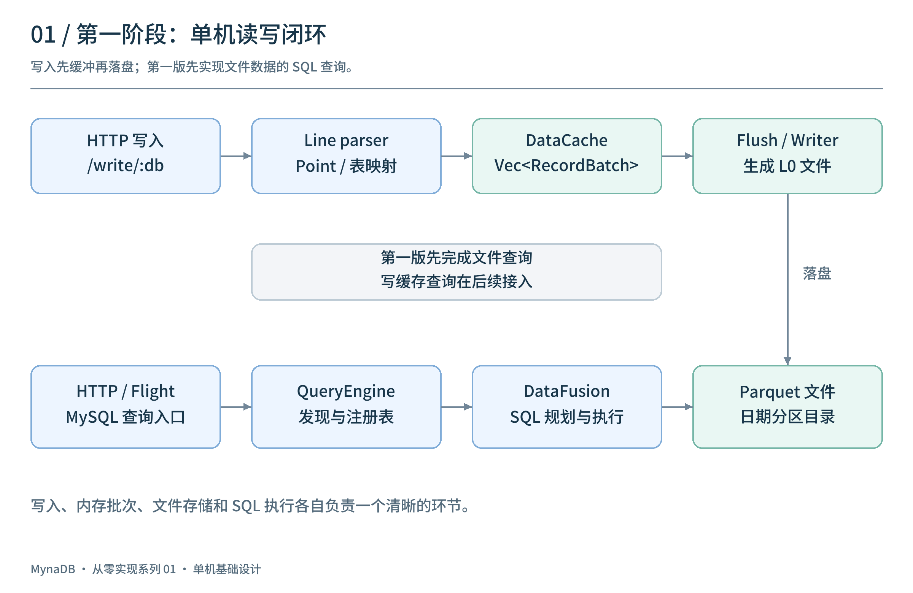
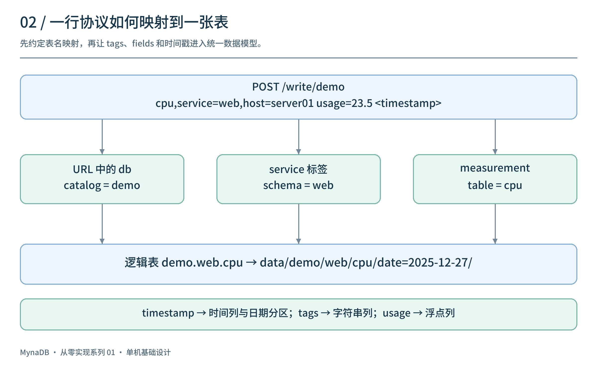
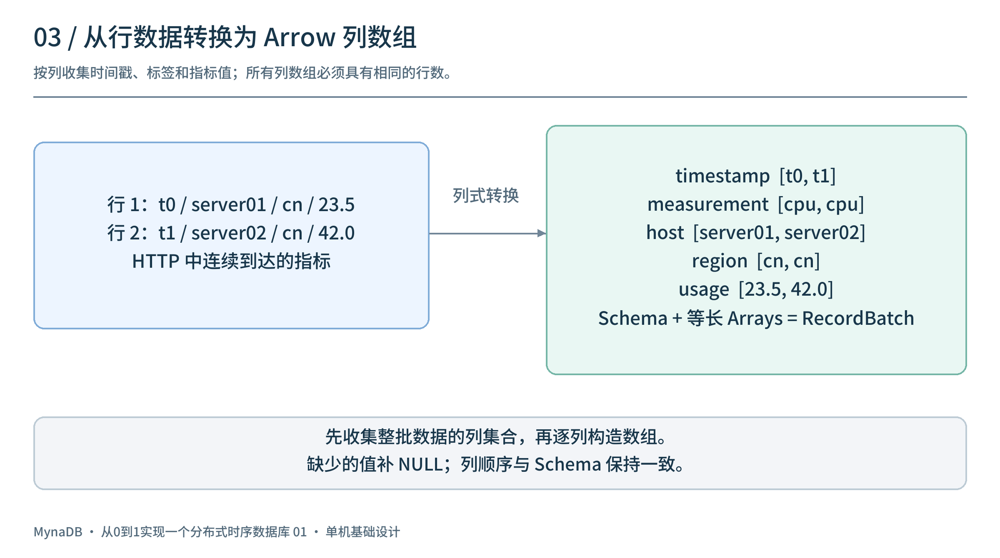
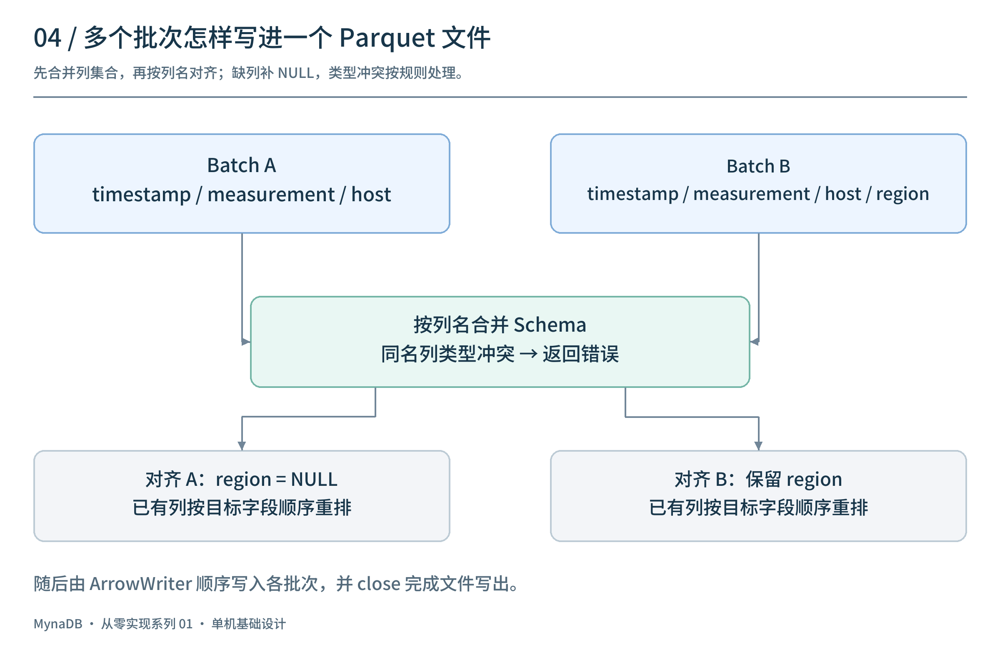
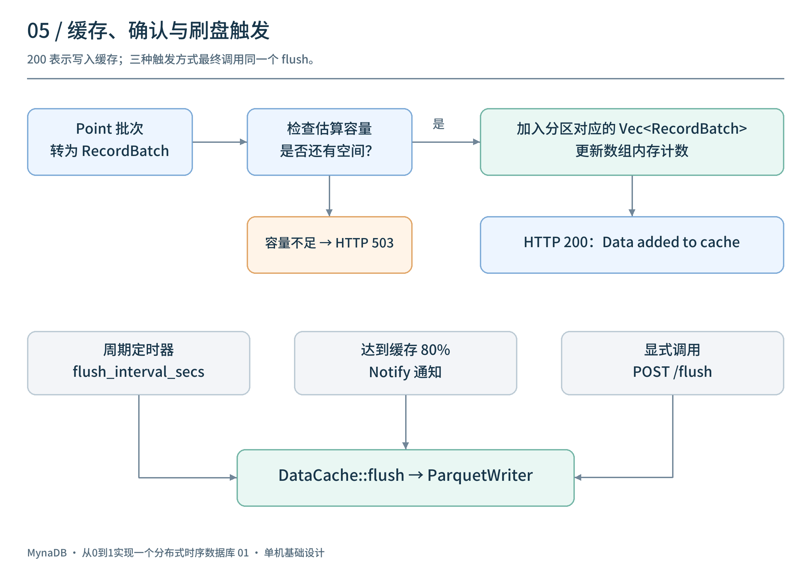
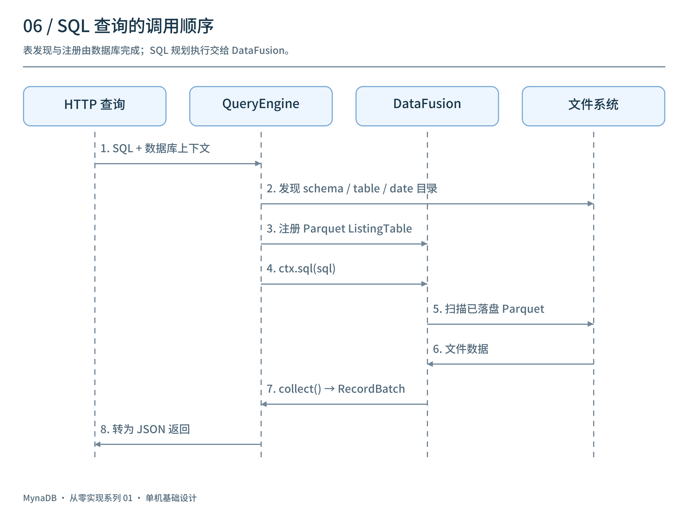
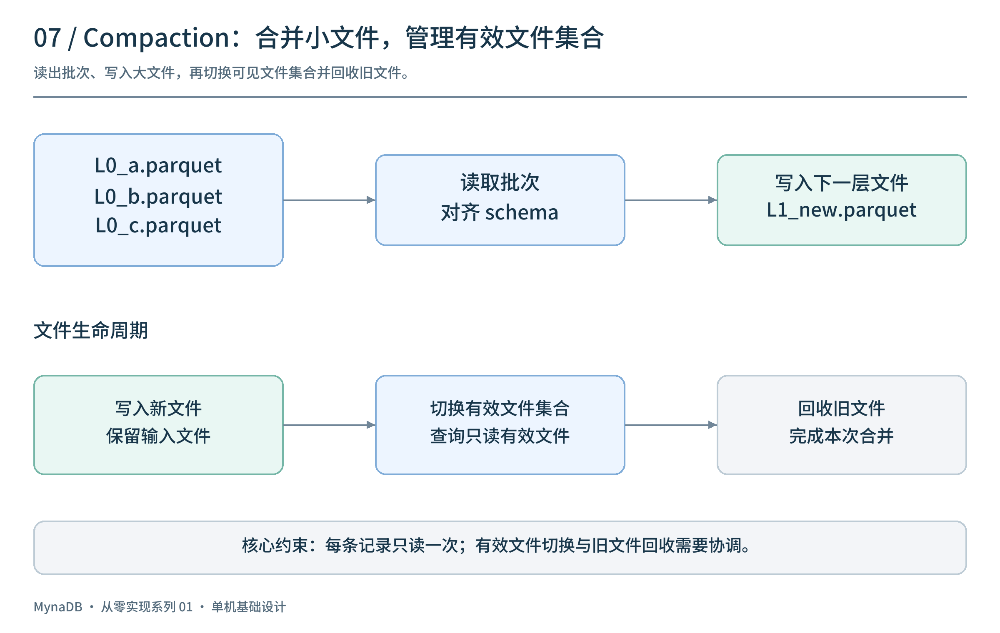
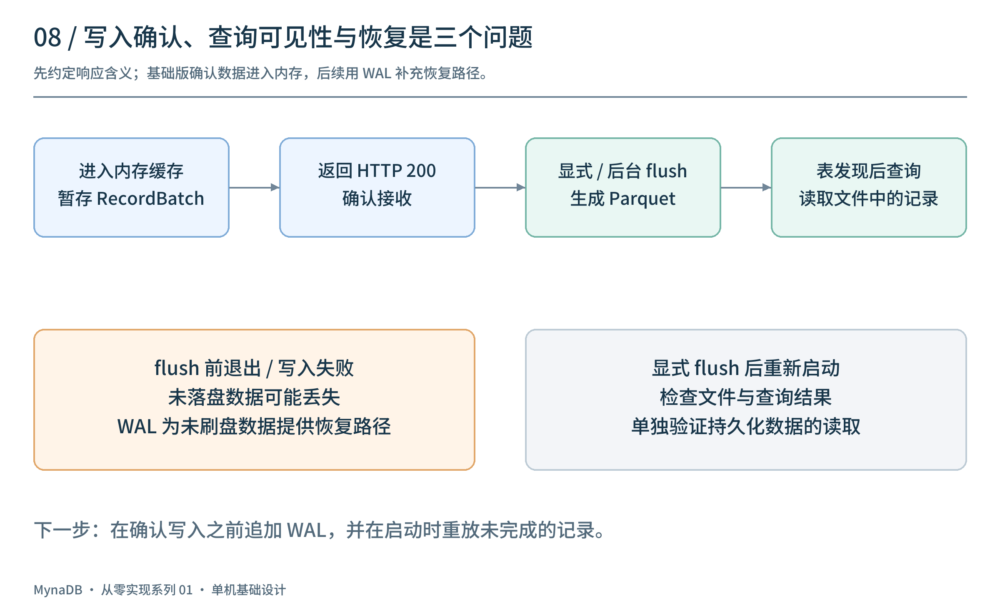

# 从0到1实现一个分布式时序数据库（一）：用 Rust、Arrow 和 Parquet 打通写入与 SQL 查询

假设你正在为几台服务器采集 CPU 使用率。每隔几秒，采集器就发来一条记录：哪台机器、什么时间、CPU 用了多少。

最初，你可以把记录追加到文本文件。过几天，需求变成了：“查一下昨天每台机器的平均 CPU 使用率。”你需要解析文件、筛选日期、按主机分组，再计算平均值。数据再多一些，还要考虑批量写入、文件数量、并发访问，以及重启后如何继续查询。

数据库的许多设计，就从这些具体问题中长出来。

这一篇，我们从空白项目开始，设计一个最小的单机时序数据库：通过 HTTP 接收指标，在内存里积累批次，写成 Parquet 文件，再用 SQL 查询。系列后续会逐步加入 WAL、复制和集群；现在先把一条数据从入口送到查询结果。

读完并完成文中的练习，你应该能回答：

- 一条时序数据如何变成表中的一行？
- 为什么按批次写文件，内存中的行又如何变成列？
- SQL 引擎如何找到数据，并算出预期结果？
- 写入成功、刷盘完成和查询可见，分别代表什么？

你需要了解基本的 Rust、HTTP 和 SQL。本文用少量数据结构和伪代码说明实现方法；接口路径是贯穿教程的设计约定，可以据此实现自己的程序。

## 1. 先定义一个可以验收的目标

先准备四条数据。下面约定时间戳单位为纳秒，统一使用 UTC；前两条属于同一天，后两条属于第二天。

```text
cpu,service=web,host=server01 usage=20.0 1766793600000000000
cpu,service=web,host=server02 usage=40.0 1766793600000000000
cpu,service=web,host=server01 usage=30.0 1766880000000000000
cpu,service=web,host=server02 usage=60.0 1766880000000000000
```

我们的验收目标很具体：

1. 向 `POST /write/demo` 发送这四条数据，服务确认接收。
2. 调用 `POST /flush`，等待文件写入完成。
3. 查询 `demo.web.cpu`，每台主机的平均值分别是 `25.0` 和 `50.0`。
4. 只查询 `2025-12-27`，结果分别是 `20.0` 和 `40.0`。
5. 停止服务，以同一数据目录重新启动，仍能查到四条记录。

为什么先列验收目标？因为“HTTP 返回成功”“目录里出现文件”都只证明了一部分功能。**输入已知，输出可计算，才能判断整条读写链路是否正确。**

第一版还约定三个行为：查询读取已经刷出的文件；一条输入记录追加为一行；重复发送同一条数据会产生重复行。这让我们可以先专注于完整读写，随后再增加内存查询、故障恢复和去重策略。

## 2. 搭出数据经过的四个模块

把整个程序分成四个部分即可：



| 模块 | 输入 → 输出 | 你要完成的工作 |
| --- | --- | --- |
| HTTP 接口 | 请求 → 写入或查询任务 | 读取请求体，校验参数，返回结果 |
| 解析与缓存 | 文本行 → 内存批次 | 解释字段类型，决定数据归属，组织批次 |
| 文件写入 | 内存批次 → Parquet 文件 | 批量刷出，处理失败，发布可查询的文件 |
| 查询引擎 | SQL → 结果批次 | 找到表和文件，执行过滤、分组与聚合 |

可以用 Tokio/Axum 实现 HTTP 接入，Arrow 表达内存数据，Parquet 保存数据，DataFusion 执行 SQL。你仍然需要设计数据模型、缓存、文件布局和可见性；SQL 的解析、执行计划和聚合计算可以交给已有引擎。

建议先从普通函数开始，打通“解析一段文本 → 写一个文件 → 读取文件并查询”，随后接上 HTTP。这样，当结果不对时，你能先检查数据转换，而不必同时排查网络与异步任务。

## 3. 定义数据模型：一条指标到底是什么

### 3.1 将输入拆成四部分

这里使用便于手工输入的 line protocol。先观察一行：

```text
cpu,service=web,host=server01 usage=20.0 1766793600000000000
│   └──────── tags ────────┘ └─ field ─┘ └── timestamp ──┘
└── measurement
```

- `measurement`：测量对象的名称，这里是 CPU 指标。
- `tags`：描述记录归属的维度，例如主机和业务。
- `fields`：实际测量值，例如 CPU 使用率。
- `timestamp`：采样发生的时间。

tags 和 fields 最后都可以表现为列，但它们承担不同的业务含义。我们通常按 `host` 分组，按 `usage` 求平均。标签值应当放在记录里：`server01` 是 `host` 列的值，不应生成一张名为 `cpu_server01` 的表。

内部先用一个容易理解的行结构接住输入：

```rust
struct Point {
    measurement: String,
    tags: HashMap<String, String>,
    fields: HashMap<String, FieldValue>,
    timestamp: i64,
}

enum FieldValue {
    Float(f64),
    Integer(i64),
    Boolean(bool),
    String(String),
}
```

示例中的 `20.0` 是浮点数。解析器也需要区分 `20i` 这样的整数、布尔值和带引号的字符串。将所有值都转成字符串虽然容易接收，却会把类型判断推迟到每次计算。

### 3.2 明确表名的映射规则

我们约定：请求路径中的 `demo` 是 catalog，`service=web` 决定 schema，`cpu` 是 table。因此，这条记录写入 `demo.web.cpu`。



这个三级命名可以理解成“数据库 / 业务分组 / 指标表”。它是本教程的组织方式，你也可以将业务归属直接放到请求参数中。关键是只定义一套规则，写入和查询共同遵守。

映射后，我们希望得到这样的逻辑表；`service` 在本教程中已经用于确定 schema：

| timestamp（UTC） | host | usage |
| --- | --- | --- |
| 2025-12-27 00:00:00 | server01 | 20.0 |
| 2025-12-27 00:00:00 | server02 | 40.0 |
| 2025-12-28 00:00:00 | server01 | 30.0 |
| 2025-12-28 00:00:00 | server02 | 60.0 |

第一版可以固定三列：`timestamp` 为非空时间列，`host` 为可空字符串列，`usage` 为可空浮点列。固定 schema 能帮助你先排除动态字段带来的问题。

### 3.3 给解析器一个清楚的边界

不要直接用一次按空格切分来实现完整协议：字符串 field 可以包含空格，标识符也存在转义规则。你可以使用协议解析库，或者先实现并明确限定一个子集，再逐步补齐。

至少检查：时间戳是否为有效整数、measurement 是否为空、field 是否存在、字段类型是否符合表结构。标签和字段重名、用户占用保留列 `timestamp` 等情况，也要明确拒绝。

本教程采用“整个请求校验通过后再接收”的策略。先解析所有行，检查结构、类型和容量，再将这一请求的数据加入缓存；任意一行有误时返回行号和原因。这样调用方能判断该请求是否被接收。这只是入口层面的约定，跨分区同时持久化还需要额外的事务设计。

**动手检查：**只实现解析函数，打印四条 Point。核对时间、主机、数值和类型。再输入一条错误时间戳，确认能指出具体行号，而不是让服务崩溃。

## 4. 按表和时间分区，决定数据放在哪里

现在有了四条 Point，接下来决定哪些数据一起缓存、一起写文件。

我们选择“一张表的一天”为一个分区：

```rust
struct PartitionKey {
    catalog: String,
    schema: String,
    table: String,
    date: i32,
}
```

`date` 可以表示从 Unix epoch 开始的天数。对纳秒时间戳，计算规则是：

```text
一天的纳秒数 = 86_400 × 1_000_000_000
分区日期编号 = timestamp.div_euclid(一天的纳秒数)
```

使用向下取整的整除，可以正确处理 epoch 之前的时间。这里按**采样时间**分区，所以今天才收到的昨天的数据，仍然进入昨天的分区。不要用服务器接收请求的日期替代它。

按日期分区有什么用？查询昨天的数据时，可以先缩小到昨天的目录。与此同时，分区也不能无限细：每秒一个目录很快会产生大量目录和小文件。日分区是便于入门的起点，实际粒度需要结合写入规模和查询范围选择。

四条样例记录会分成两组，每组两条：

```text
(demo, web, cpu, 2025-12-27) → server01:20.0, server02:40.0
(demo, web, cpu, 2025-12-28) → server01:30.0, server02:60.0
```

注意，这一步尚未写文件，只是在确定数据归属。同一个请求完全可以包含多张表和多个日期，不能只看第一条记录就决定整个请求的目标分区。

**动手检查：**加入两条分处 UTC 午夜前后、相差一纳秒的记录，检查它们是否进入相邻日期；再加入一条晚到记录，确认它仍然按采样日期分组。

## 5. 把行转换成 Arrow 列式批次

### 5.1 为什么要转换数据布局

接收一行、解析一行很自然，但分析查询常常只需要部分列。计算 `AVG(usage)` 时，主要需要读取数值列；按主机分组时，再读取 `host` 列。

Arrow 的 RecordBatch 表示“一份 schema + 一组等长的列数组”。第一天的两条记录可以转换成：



```text
schema:
  timestamp: Timestamp(Nanosecond, UTC), 非空
  host:      Utf8, 可空
  usage:     Float64, 可空

columns:
  timestamp: [1766793600000000000, 1766793600000000000]
  host:      ["server01", "server02"]
  usage:     [20.0, 40.0]
```

同一行的数据，通过相同的数组下标关联起来。比如下标 `1` 对应 `server02` 和 `40.0`。因此，所有列必须拥有相同的行数，数组顺序也必须与 schema 中的字段顺序一致。

实现时，先确定列的顺序，再遍历每条记录，为每一列追加值。不要直接依赖 HashMap 的遍历顺序构建列。

```text
对分区中的每条 Point：
    向 timestamp 数组追加时间
    向 host 数组追加主机；缺失则追加 NULL
    向 usage 数组追加数值；缺失则追加 NULL
最后用 schema 和三个数组构建 RecordBatch
```

### 5.2 缺失值为什么不能随手填零

假设第三条记录没有 `usage`。它表示“没有提供测量值”，而 `usage=0.0` 表示“测量结果为零”，两者不同。

如果第一台主机的数据是 `[20.0, NULL]`，SQL 的 `AVG(usage)` 会忽略 NULL，得到 `20.0`；如果你把缺失值改成零，平均值就变成了 `10.0`。一个看似方便的默认值，会直接改变业务结果。

所以，缺失字段需要追加一个 NULL，而不能跳过该数组的这一行，也不能擅自补零。

### 5.3 固定 schema 跑通后，再支持新列

接着尝试给第二批数据增加 `region` 标签。你会遇到两个问题：新批次多了一列，旧文件却没有这列；同名列还可能出现不同类型。



可以采用一个容易验证的策略：

1. 维护表级 schema，确定所有已知列的名字、类型和顺序。
2. 新列先经过校验，再加入目标 schema。
3. 每个批次按目标 schema 对齐，缺失的列补相同类型的 NULL。
4. 同名列出现类型冲突时，第一版直接拒绝，并返回冲突列名。

对齐必须按列名进行。两个批次即使列数相同，也不能仅凭数组位置把它们拼起来。

入门实现可以先固定 schema，并将它保存到表目录的元数据文件中，启动时重新加载。实现动态列后，再支持 schema 更新；旧文件读取时也要补齐缺失列。**内存中能构建新列，不代表多文件查询已经支持 schema 演进。**

Arrow 在这里统一了模块之间的交接方式：缓存保留 RecordBatch，Parquet 写入器接收 RecordBatch，SQL 查询也返回 RecordBatch。业务代码不需要在每个边界重新设计一种数据格式。

**动手检查：**构建含两行的批次，核对列数、行数和类型；再让其中一行缺少 `host`，确认另一列的行数仍然一致，并且缺失位置为 NULL。

## 6. 设计缓存：积累多少数据才写文件

如果每收到一个请求就创建文件，一秒钟 100 个小请求，一分钟就可能产生 6,000 个文件。打开文件、读取元数据和调度读取都会消耗资源。

因此，在解析与文件之间增加缓存：

```text
HashMap<PartitionKey, Vec<RecordBatch>>
```

同一分区的批次暂存在一起，积累到一定规模后刷出。



### 6.1 同时考虑容量和等待时间

教程可以先采用一组便于观察的配置：例如缓存预算 64 MiB，达到预算的 80% 时通知后台刷出；低流量时每隔 5 秒刷出一次；保留手动 `/flush` 入口做验证。这些是实验参数，实际值需要根据内存、写入吞吐和文件大小调整。

只按容量触发，低流量数据可能长时间留在内存；只按时间触发，高流量又可能在下一次定时任务之前耗尽内存。因此，两种触发条件需要共同工作。

缓存大小尽量按批次占用的内存估算，不能只计算原始请求体长度。解析后的字符串、Arrow 数组和临时对象都会占用额外空间。进程还需要为查询和文件编码预留内存。

### 6.2 写文件时怎样继续接收数据

一个简单的实现是：在锁内取出待刷批次，随后释放锁，在锁外执行文件 I/O。新请求继续进入活动缓存。

```text
活动缓存 ──取出──→ 待刷批次 ──写文件──→ 已发布文件
    ↑                 │
新请求进入         失败则保留重试
```

取出批次并不代表内存已经释放。文件写入结束前，批次仍然存在，因此内存预算要同时计算活动缓存和待刷数据。否则，刷盘越慢，后台积压越多，程序仍可能耗尽内存。

第一版可以只保留一个刷盘 worker，避免定时、容量和手动触发同时处理同一批数据。容量不足时，入口返回可重试的错误，让采集端稍后再发；如果继续无上限地接收，故障只会被推迟。

手动 `/flush` 应等待本次取出的批次完成，而不是只发送一个后台通知就返回。这样，“调用 flush 后查询”的验收过程才有明确的等待边界。并发发生的新写入可以留给下一轮刷盘。

## 7. 写入 Parquet，并让完整文件进入查询

### 7.1 区分内存格式和文件格式

Arrow 负责内存中如何组织数据，Parquet 负责文件中如何保存数据。Parquet 按列组织数据，支持编码、压缩和统计信息；查询引擎可以据此减少读取和解码的数据量。

一个 Parquet 文件可以包含多个 row group，每个 row group 内又按列存放数据。它与 RecordBatch 没有必须一一对应的关系：你可以向同一个 writer 多次提交批次，由写入配置控制文件内部布局。

本教程采用按日期组织的目录：

```text
data/
└── demo/
    └── web/
        └── cpu/
            ├── date=2025-12-27/
            │   └── part-000001.parquet
            └── date=2025-12-28/
                └── part-000002.parquet
```

`date` 来自目录分区，不必重复写进每个物理文件。查询注册表时，将它声明为分区列即可。文件名使用不会与已有文件冲突的编号或标识；重启后也不能重新从 `1` 开始覆盖旧文件。

### 7.2 一次刷出要经过哪些步骤

```text
取出一个分区的待刷批次
    → 按统一 schema 对齐
    → 创建临时文件
    → 逐批写入 Parquet
    → 关闭 writer，完成文件尾部元数据
    → 将完整文件发布到查询目录
    → 标记批次完成并释放内存
```

Parquet 的文件尾部包含读取所需的元数据。写入过程中出现的半成品文件，不应该被查询引擎当作完整文件读取。

在本地文件系统上，可以先写到同一文件系统内的临时路径，完成后再通过 rename 发布，并确保查询只发现最终文件。需要更强的断电持久性时，还要正确同步文件和目录；仅仅关闭 writer，不足以证明断电恢复能力。

这里先实现单文件发布。一次请求跨多个分区生成多个文件时，它们分别完成发布，不具备整批同时可见的事务语义。

### 7.3 失败时，数据留在哪里

写文件失败时，待刷批次必须继续被程序持有，供重试或报告失败。不要在开始写之前就永久清除它们。

还要区分“发布之前明确失败”和“文件已经发布但完成状态尚未记录”。前者可以重新尝试写入；后者如果直接生成另一份文件，可能产生重复数据。第一版至少应为一次刷盘保留稳定的任务标识和目标文件名，并记录当前阶段，避免在同一进程里盲目重试。

进程崩溃后的恢复需要后续 WAL 和元数据机制补齐。此时先把正常路径与明确的 I/O 错误处理清楚。

**动手检查：**刷出样例数据，检查两个日期目录；再将测试输出目录设为不可写，观察 flush 是否返回错误、待刷批次是否仍被保留。恢复目录权限后，重试并核对记录数。

## 8. 让 SQL 引擎知道表和文件在哪里

### 8.1 从表名找到目录

现在文件已经存在，但 SQL 中的 `demo.web.cpu` 还需要对应到文件目录。查询引擎必须维护这层关系：

```text
SQL 表名 demo.web.cpu
    → catalog demo / schema web / table cpu
    → data/demo/web/cpu/
    → 该表下已经发布的 Parquet 文件
```



入门实现可以先手动注册一张表：创建 catalog 和 schema，将表目录包装为 Parquet 表提供者，并声明日期分区列。跑通后，再通过元数据或目录发现，在启动时注册所有表。

为了便于调试，第一版也可以在 flush 后刷新文件列表。需要明确检查所使用的表提供者如何发现新增文件，避免把旧列表永久保存在内存中，导致“文件写成功，查询却一直看不到”。

目录名来自用户输入时，也需要校验名称或编码，防止表名中的路径分隔符改变实际写入位置。

### 8.2 一条 SQL 是如何得到结果的

执行 SQL 大致经过：解析 SQL、解析表与列、生成执行计划、扫描文件、过滤记录、分组聚合，最后产生结果批次。使用 DataFusion 后，你主要负责提供正确的表、schema 和文件，执行引擎负责这些计算步骤。

先查总数：

```sql
SELECT COUNT(*) AS rows
FROM demo.web.cpu;
```

预期结果为 `4`。再查平均值：

```sql
SELECT host, AVG(usage) AS avg_usage
FROM demo.web.cpu
GROUP BY host
ORDER BY host;
```

| host | avg_usage |
| --- | --- |
| server01 | 25.0 |
| server02 | 50.0 |

加上 `ORDER BY`，是为了让验收结果的顺序稳定。没有排序条件时，不应假定数据库总按某个顺序返回结果。

### 8.3 分区过滤与时间过滤分别做什么

如果注册时把 `date` 声明为 Date32 类型的分区列，可以查询第一天：

```sql
SELECT host, AVG(usage) AS avg_usage
FROM demo.web.cpu
WHERE date = DATE '2025-12-27'
GROUP BY host
ORDER BY host;
```

预期结果为 `20.0` 和 `40.0`。这里的日期条件可以帮助查询引擎选择分区。

如果用户要查询某一小时，还需要对 `timestamp` 列施加准确的时间范围条件。日期分区负责缩小候选文件，记录级时间条件负责确定哪些行真正满足要求。两者不能互相替代。

时间范围推荐采用左闭右开形式：`timestamp >= start AND timestamp < end`。查询相邻时间段时，边界记录只属于其中一段，不会因两边都包含结束时刻而重复统计。

第一版先显式提供分区条件。随后再研究如何从时间范围推导日期分区，以及查询计划是否实际减少了文件或 row group 的读取。

### 8.4 将结果交还给调用方

DataFusion 返回 RecordBatch。HTTP 层按列名和行下标组装 JSON，保留数字、布尔值和 NULL 的类型；时间戳约定统一的输出格式，例如 UTC 的 RFC 3339 字符串。

小结果可以先整体返回。等结果集变大后，再增加行数限制、分页或流式输出。不要让一次查询将无限量结果收集到内存。

## 9. 用一组实验把整个闭环验收下来

现在再接上 HTTP，就有了可操作的外部接口。先将四条样例数据保存到 `points.lp`，再按前文约定实现下面的写入接口：

```bash
curl -i -X POST http://localhost:8080/write/demo \
  -H 'Content-Type: text/plain' \
  --data-binary @points.lp
```

随后手动刷出：

```bash
curl -i -X POST http://localhost:8080/flush
```

查询接口可以约定为 `POST /query`，请求体包含 `sql`，然后提交前面的总数、平均值和日期过滤查询。接口具体命名可以调整，验证的顺序保持一致：

| 实验 | 操作 | 应当观察到的结果 |
| --- | --- | --- |
| 完整读写 | 写入四条，等待 flush，再查总数 | 4 行 |
| 数值计算 | 按 host 求平均 | 25.0、50.0 |
| 日期分区 | 只查询第一天 | 20.0、40.0 |
| 正常重启 | flush 后停止并重新启动 | 总数仍为 4，平均值不变 |
| 无效输入 | 请求中放入错误时间戳 | 请求被拒绝，总数不变 |
| 重复提交 | 再发送相同四条并 flush | 追加模型下总数变成 8 |
| 字段缺失 | 增加一条仅含其他 field（如 temperature）的记录 | 对应列为 NULL，COUNT(*) 与 COUNT(usage) 的差异可解释 |

重复提交的实验尤其有用。平均值有时不会因整批重复而改变，单独核对平均值可能漏掉重复行；把总数和聚合结果一起验证，才更容易发现问题。

最后尝试一个故障实验：使用全新数据目录，暂时关闭周期和容量自动刷出，写入数据后，在 flush 前强制结束进程。重启后，未刷出的数据不会自动恢复。这个结果揭示了第一版的确认语义，也说明下一步为什么需要 WAL。

## 10. 数据持续写入后，怎样控制小文件

第一版跑通以后，持续运行会产生越来越多文件。即使每次已经合并了多个请求，一天内也可能有很多次 flush。

Compaction 就是把若干已有文件重新写成较少、较大的文件：



基本步骤是读取输入文件、对齐 schema、写出新文件，再让新文件替换旧文件集合。合并可以按时间排序，为后续压缩和范围读取创造更好的数据布局；它本身不应擅自改变记录含义。

先记住一个约束：**查询不能同时把某组输入文件及其完整合并结果都算进去。** 否则合并一次，总数可能从 4 变成 8。

因此，文件数量增长到需要合并时，应引入有效文件清单或相应的快照机制。查询读取某一版本的有效文件集合，合并完成后再切换清单；仍被旧查询使用的文件，要延后回收。简单地“把新文件放进扫描目录，再逐个删除旧文件”，无法保证并发查询期间结果正确。

实现顺序上，可以先完成前九节的读写验收，再增加 Compaction。合并前后比较总数、分组平均值和时间范围结果，确认减少文件没有改变数据。

## 11. 最后，把三个时间点分开

经历完整实现后，我们再看“写入成功”这句话：



| 时间点 | 本教程中的含义 | 此时能否通过文件查询读到 |
| --- | --- | --- |
| 接收成功 | 校验通过，数据进入内存缓存 | 尚不能保证 |
| 刷盘完成 | 对应批次已写成完整文件并发布 | 需要查询侧发现新文件 |
| 查询可见 | 查询使用的文件集合已包含这些数据 | 可以 |

这三个时间点可能相隔一段时间。入口响应快，可能只是因为它确认了内存接收；正常重启后能读到文件，也只验证了已经刷出的数据可以重新加载。

到这里，你已经设计了一条可检验的路径：文本记录经过解析，按表和日期分组，转换为列式批次，在内存积累后写入文件，最后由 SQL 引擎完成过滤和聚合。实现过程中最值得掌握的，是每一步输入什么、输出什么，以及失败时数据仍然由谁持有。

接下来给自己留三个练习：将固定 schema 扩展为允许新增标签列；观察不同刷盘间隔如何影响文件数量和查询可见延迟；在重启实验中区分已刷出与未刷出的记录。

[第二篇](../02-wal-and-recovery/article.md)会继续解决最后一个问题：在确认写入之前记录 WAL，并在启动时重放，让还没有进入 Parquet 的数据也有恢复路径。

项目：[panbooks/mynadb](https://github.com/panbooks/mynadb) · [中文文档](https://panbooks.github.io/mynadb-portal/zh/index.html)。
