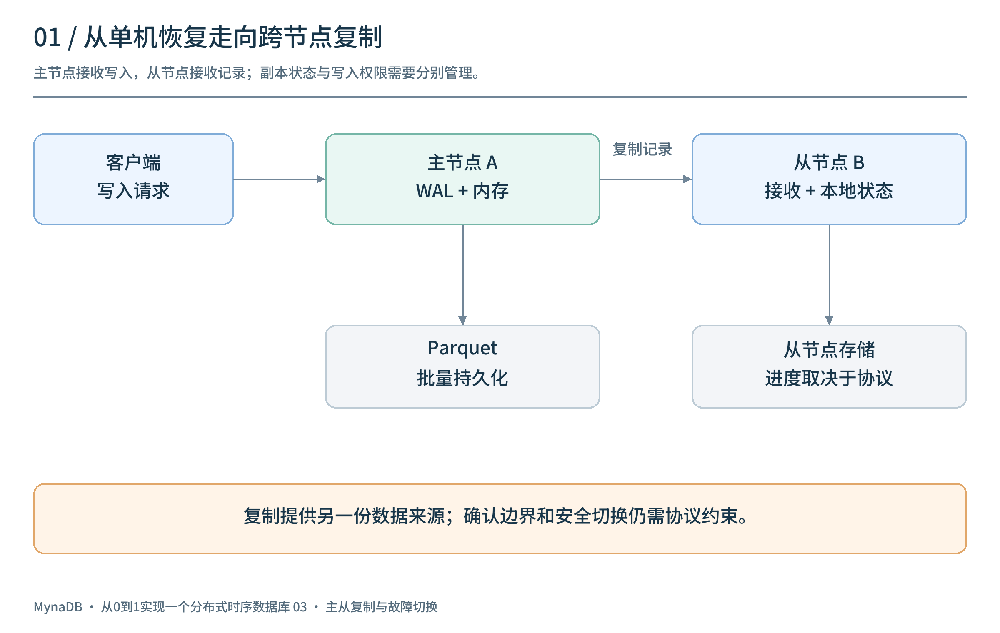
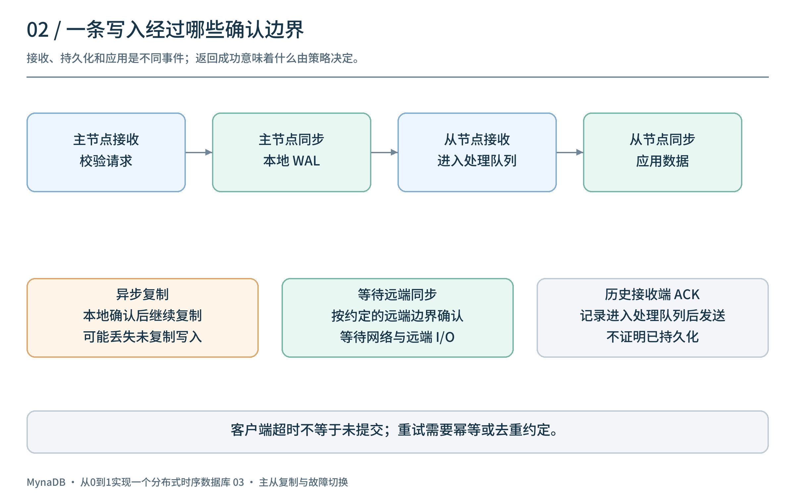
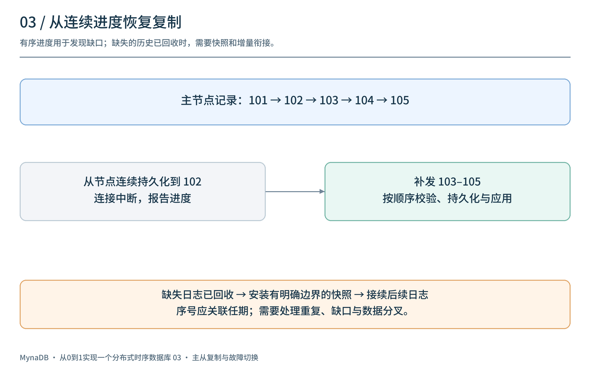
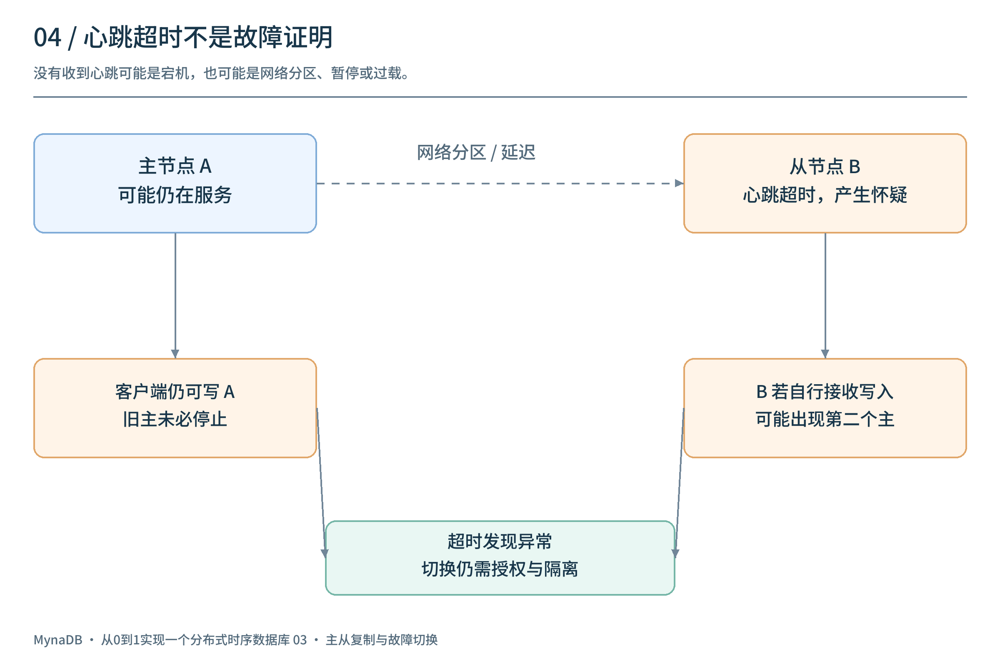
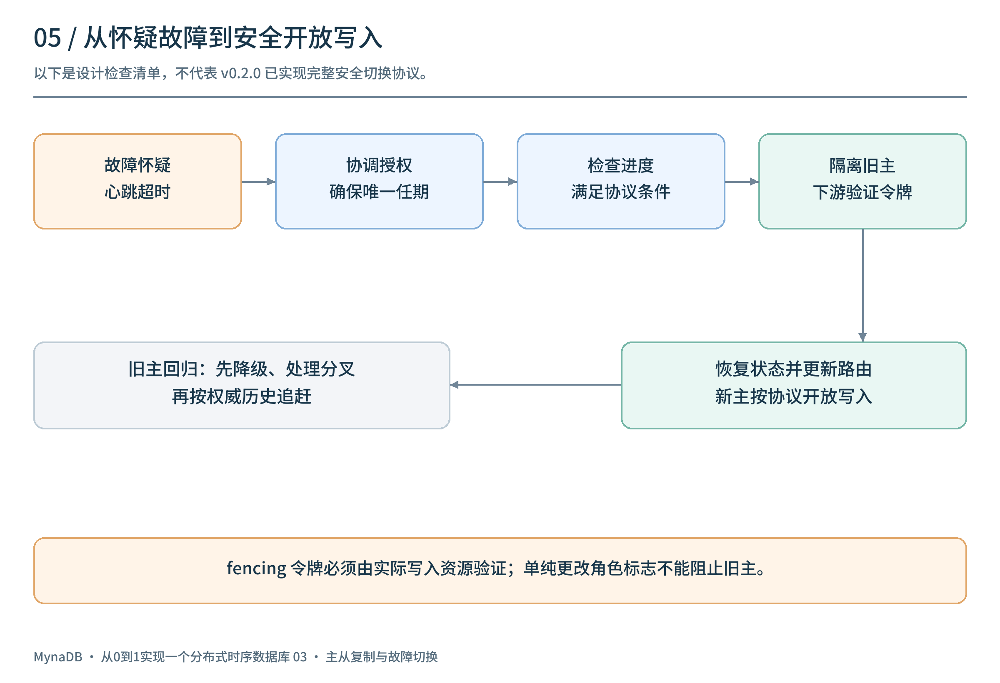
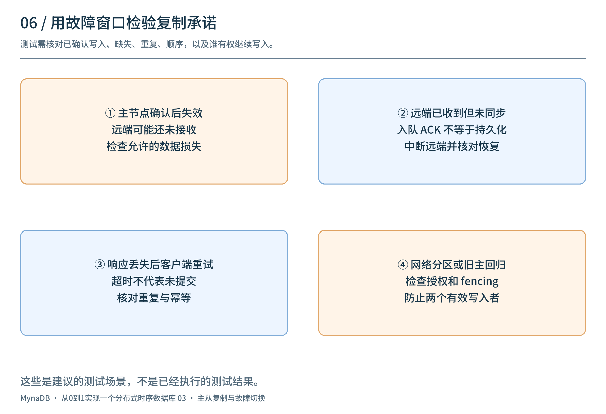

# 从0到1实现一个分布式时序数据库（三）：主从复制、故障检测与切换

[上一篇](../02-wal-and-recovery/article.md)讨论了单机如何用 WAL 找回尚未刷出的写入。但如果故障的不只是进程，而是整台机器和它的磁盘，保存在本机的日志也可能暂时不可用。**如何让另一台机器接过服务，又怎样避免两台机器同时接受写入？**

这一篇以 `v0.2.0` / M3 的早期主从高可用探索为线索，讨论复制、心跳、切换和脑裂。为讲清安全边界，文中部分流程是设计示意，并非声称该历史版本已经完整实现。该版本中的旧 HA 子系统后来在 `v0.3.0` 被移除；它不是后续 Router / Data / Meta 集群的实现。

## 1. 一份数据，两台机器

单机 WAL 解决的是“本机恢复时从哪里重放”；复制要进一步解决“另一台机器能接收到什么”。最直观的布局是一台主节点负责接收写入，一台从节点接收复制记录，并在本地保存和应用。



两份副本能降低单机故障造成的不可用，但**有第二份副本不代表每条已确认写入都已经复制，更不自动保证切换安全**。具体保障由确认策略、故障检测和写入权限共同决定。

`v0.2.0` 的历史源码中，`ReplicatedWalEntry` 包含序号、时间戳、数据库、负载和 CRC32 校验；发送端和接收端使用 TCP 传递消息。它建立了理解复制的起点，但字段存在并不意味着恢复、补发和持久化已经形成完整保证。

## 2. 一条写入，应该确认到哪一步？

把复制链路拆开，可以看到多个不同的进度：主节点已接收、本地日志已同步、从节点已接收、从节点已同步、从节点已应用。这些不是同一件事。



| 确认策略 | 示意确认条件 | 需要承担的代价或风险 |
| --- | --- | --- |
| 异步复制 | 主节点按本地策略完成后即可响应，从节点随后追赶 | 主节点永久丢失时，尚未复制的已确认写入可能丢失 |
| 等待从节点持久化 | 本地及指定从节点按约定同步日志后响应 | 增加网络和从节点 I/O 等待；从节点不可用时要决定拒绝还是降级 |
| 多副本法定人数确认 | 按协议要求，等待足够数量的副本持久化 | 需要完整的成员、选主和提交协议；不是多等几个 ACK 就能安全切换 |

复制确认并不等于客户端一定收到了响应：主节点完成提交后网络断开，客户端仍可能超时。重试会产生什么结果，需要另行定义幂等键或去重规则。

历史实现的具体边界需要特别注意：接收端校验后，**先把记录放入处理队列，然后发送成功 ACK**；这不能证明从节点已经写入或同步本地 WAL。发送端虽然定义了等待 ACK 的方法，但该版本的 `replicate_write` 调用的是排队发送路径。因此不能把这个历史版本描述为“已确认写入至少持久化在两台机器”。

## 3. 从发送到追赶：序号能解决什么？

复制记录通常需要一个在某个主节点任期内有序的标识。主节点发送记录，从节点按顺序接收和应用；断线重连时，从节点报告自己的连续进度，主节点再决定从哪里补发。



例如，主节点已经产生 `101–105`，从节点只连续持久化到 `102`。重连后应从 `103` 补齐；如果主节点已经回收所需历史记录，就需要先安装包含明确边界的快照，再接续后续日志。快照和增量衔接必须保证不漏记录；收到重复记录时需要确定的去重或幂等规则。

一个序号本身不够：还要规定序号属于哪个任期、如何持久化、是否存在缺口，以及主节点切换后如何比较。若以 `104` 已到达就宣称 `103` 一定完成，可能掩盖缺口。

在 `v0.2.0` 中，握手消息携带 `last_sequence`，但发送端并未据此实现历史记录补发；Parquet 文件通知处理也标有 TODO。它适合作为复制协议原型来阅读，不能据此假设断线重连后一定能自动补齐数据。

## 4. 心跳超时：发现的是怀疑，不是事实

心跳提供活性信号。主节点定期发送心跳，从节点记录最近收到的时间。如果超过超时阈值，可以进入“疑似故障”状态，并根据策略决定下一步。



但网络中断、机器暂停、过载和真正宕机，都可能表现为“没有收到心跳”。例如：

```text
主节点 A 仍在运行  ── 网络分区 ──  从节点 B 收不到 A 的心跳
       │                                      │
   客户端仍能连接 A                    B 怀疑 A 已经故障
```

如果 B 仅凭超时就对外接受写入，而 A 仍能接受写入，就形成两个主节点：这就是**脑裂**。各自写入的数据如何合并、哪些写入被认为有效，都不能靠心跳回答。

`v0.2.0` 的故障检测器使用心跳超时和连续失败阈值通知故障事件；历史代码中的 `MasterDown` 是节点本地判断，不能理解为多数派已经确认旧主失去写入权。

## 5. 安全切换需要哪些额外约束？

如果要把原型发展成安全的自动切换协议，至少需要明确：谁有权选主、候选节点是否拥有足够新的数据、旧主如何被阻止继续写入，以及客户端如何找到新主。



下面是**设计检查清单**，不是对 `v0.2.0` 行为的描述：

1. **获得授权**：使用明确的协调机制，例如经过完整设计和验证的共识协议或外部协调服务；避免多个节点分别宣布自己是主。
2. **校验数据进度**：依据协议确认候选节点满足已提交数据的选举条件；异步复制场景要明确可能丢失的范围。
3. **隔离旧主**：使用单调递增的任期或 fencing token，并由实际执行写入的下游资源验证旧令牌；仅生成令牌而没有检查它，不能阻止旧主写入。
4. **完成切换再开放写入**：恢复必要状态、更新路由，并根据协议建立新的写入与复制关系。
5. **旧主回归先降级和追赶**：不得直接恢复旧主身份；必要时丢弃或人工处理分叉的数据，再从权威历史重新同步。

若使用租约，还必须定义时钟与超时假设，并处理暂停和时钟偏差；租约失效并不会自动阻止不检查租约的旧主继续写入。复制、选举与 fencing 必须作为一个完整协议来验证。

历史源码的 `Promoter::promote` 明确将应用待处理记录、关闭旧连接、更新配置等列为未来工作，目前主要切换内存中的角色和状态。它不是上述安全切换协议，也不能证明零停机或网络分区安全。

## 6. 切换之后：读、写与故障窗口

切换流程不仅改变节点角色，还影响客户端和观察到的数据。



| 故障位置 | 要问的问题 | 需要验证的行为 |
| --- | --- | --- |
| 主节点确认后，从节点尚未收到 | 如果主节点磁盘永久丢失，允许丢多少？ | 对照确认策略和恢复点目标，检查已确认数据 |
| 从节点收到但尚未持久化 | ACK 究竟代表入队、落盘还是同步？ | 中断从节点，核对重启后保留的记录 |
| 客户端响应丢失 | 客户端超时后重试是否会重复？ | 用稳定请求标识核对重复与冲突处理 |
| 网络分区 | 谁仍有写入权？旧主能否被隔离？ | 确认不会出现两个有效写入者 |
| 切换中或旧主恢复 | 路由何时更新？旧数据如何追赶？ | 检查错误响应、分叉处理和重新加入流程 |

读取从节点时也要说明一致性：异步复制可能读到旧数据；希望“写后立即读到”，需要将读取送到满足对应进度的节点，或使用明确的同步机制。不能只因为节点在线就假定其数据最新。

测试可以先从本地进程终止、网络中断、重复消息、延迟和磁盘写入失败入手，再覆盖多节点并发与长期运行。每条测试数据使用稳定标识，核对已确认记录、缺失、重复和顺序；`kill -9` 不等同于断电，也不能单独证明网络分区安全。以上是建议的验证计划，不是本文已完成的测试。

## 7. 回看这一阶段

从单机 WAL 到复制，系统需要回答的核心问题发生了变化：

- WAL 回答**本机恢复时从哪里重放**；复制需要回答**另一台机器真正拥有了什么**。
- 心跳可以帮助判断异常，但**超时不能证明旧主已经停止写入**。
- 自动切换需要把数据进度、选主、fencing 和客户端路由连起来，不能只修改角色标志。

`v0.2.0` 是一次早期主从复制和高可用的探索，后续 `v0.3.0` 移除了这套子系统并转向对象存储抽象。下一篇将从这个转折出发，讨论如何把本地文件访问与对象存储接口分开。

项目源码：[panbooks/mynadb](https://github.com/panbooks/mynadb) · [v0.2.0 源码](https://github.com/panbooks/mynadb/tree/v0.2.0) · [中文文档](https://panbooks.github.io/mynadb-portal/zh/index.html)。
