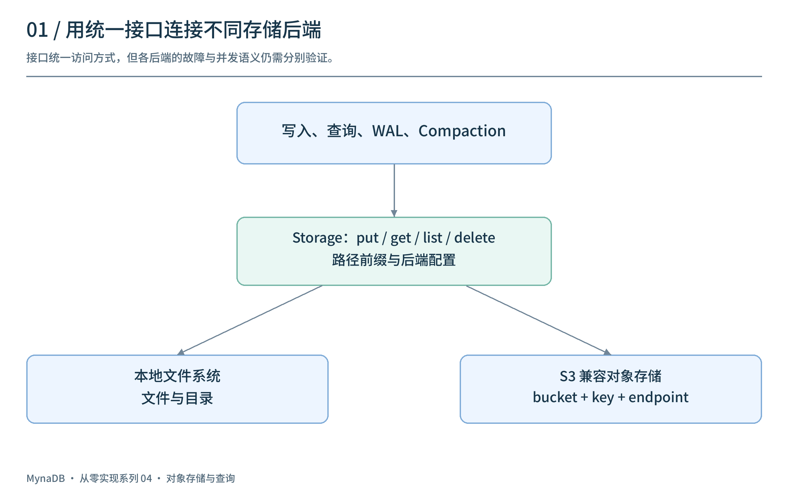
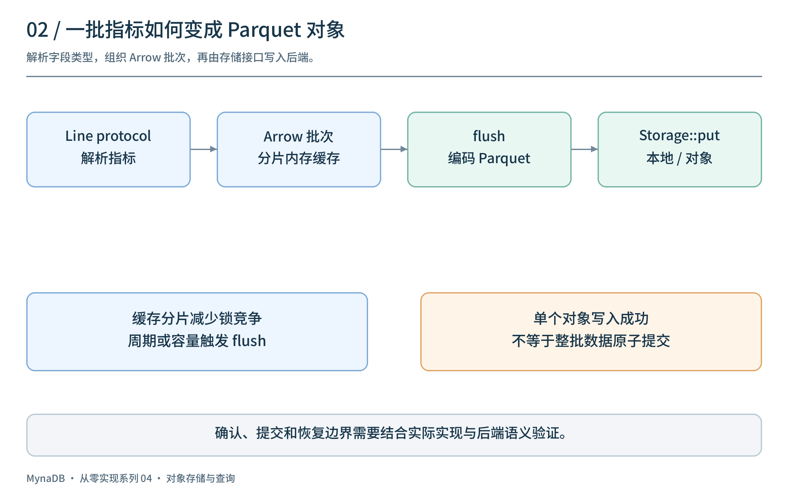
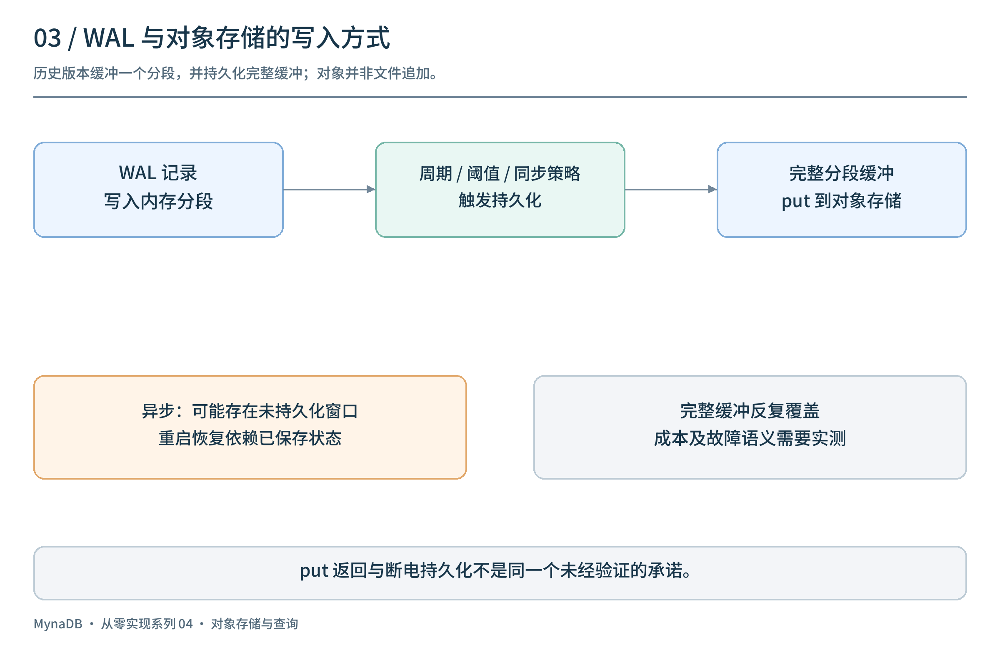
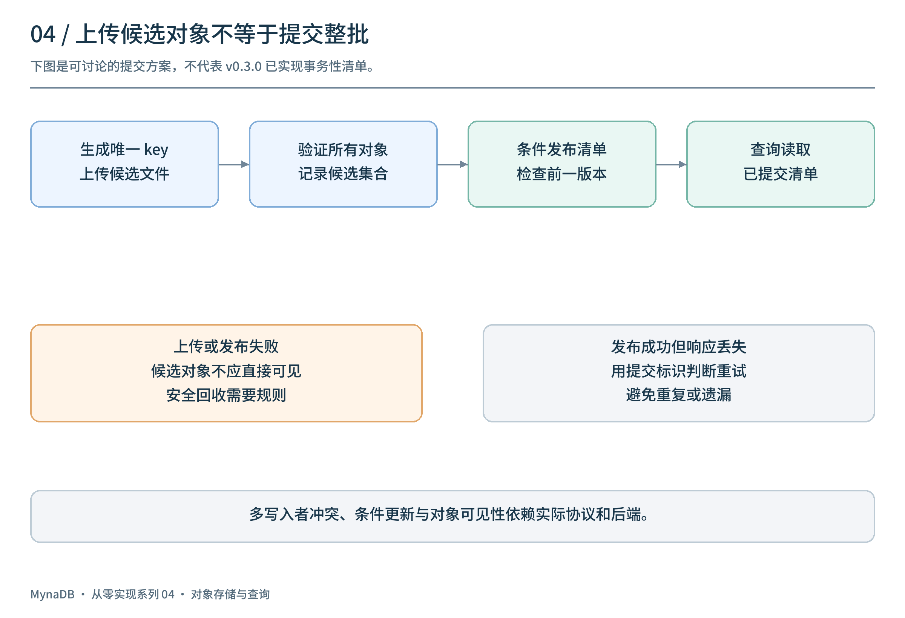
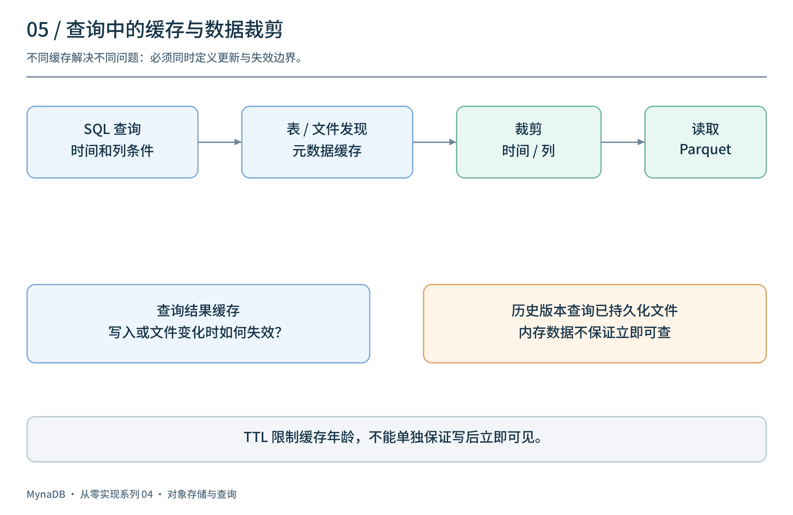
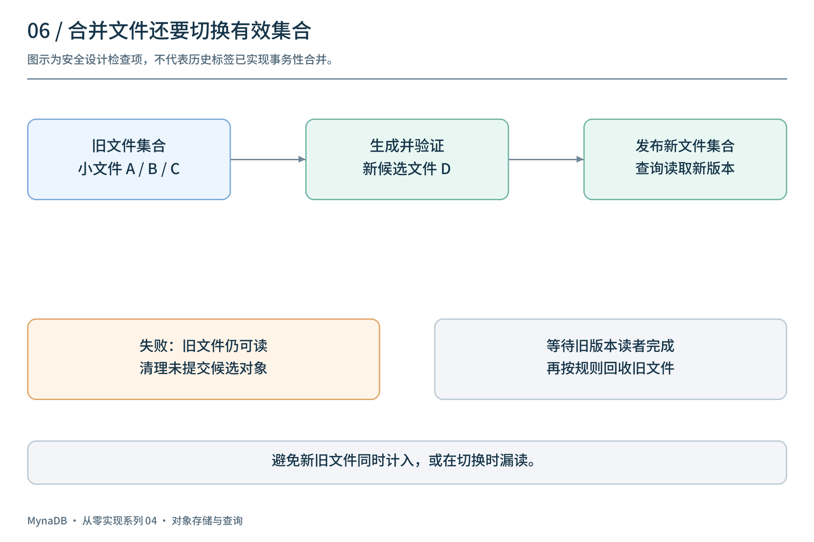

# 从零实现一个时序数据库（四）：从本地文件走向对象存储

[上一篇](../03-replication-and-failover/article.md)讨论了复制和故障切换。另一个方向是把数据文件放到独立的存储服务：计算节点不再把某个本地目录视为唯一的数据来源。但把路径从 `/data/...` 改成 `s3://...`，并不会自动解决持久化、缓存一致性和并发写入。

这一篇以 `v0.3.0` / M4 为线索，讲解存储接口、Parquet 写入、对象存储上的 WAL 和查询缓存。文中明确标出的提交协议与测试清单是设计讨论，并非历史版本已实现的保证。

## 1. 为什么需要存储抽象？

最初，写入 Parquet 的代码可以直接操作本地文件。引入对象存储后，业务层仍然需要写入、读取、列举和删除数据，但底层的地址、认证和访问语义发生了变化。



`v0.3.0` 的 `Storage` 封装了 `put`、`get`、`list`、`delete` 等操作，通过配置选择本地文件系统或 S3 兼容后端。其 S3 构造路径支持配置 bucket、region、凭据和自定义 endpoint，用于对接 S3、MinIO 等服务。

统一接口降低了业务代码对具体后端的依赖，但**同一组方法名不代表不同后端具备相同的故障、原子性和并发语义**。每一种兼容服务仍需独立验证。

| 关注点 | 本地文件系统 | 对象存储 |
| --- | --- | --- |
| 地址 | 路径及目录 | bucket、对象 key 和可选前缀 |
| 写入方式 | 可以使用文件追加及文件系统 API | 通常以对象上传或覆盖为单位 |
| 目录 | 文件系统目录与目录项 | 通常使用 key 前缀模拟层级 |
| 故障 | 进程、文件系统或设备异常 | 还包括网络、认证、限流和远端服务异常 |
| 并发 | 依赖具体文件系统和锁机制 | 依赖服务支持的条件写入、版本或外部协调 |

## 2. 一批指标如何变成 Parquet 对象？

写入入口接收 line protocol，解析出 measurement、tags、fields 和时间戳；缓存按数据归属组织 Arrow RecordBatch，达到周期或容量条件后，将批次交给 Parquet 写入器。



```text
写入请求 → 解析并构建 Arrow 批次 → 内存缓存
         → flush → 编码 Parquet → Storage::put → 存储后端
```

`v0.3.0` 引入了分片写入缓存，字段值也以浮点数、整数、字符串和布尔类型进入 Arrow 批次；flush 前的数据可按时间排序。缓存分片可以减少不同写入之间对同一把锁的竞争，但它不自动保证所有写入在故障后都能恢复。

flush 成功还要回答：哪些文件属于同一次提交？部分文件写入成功、部分失败时如何处理？历史版本的实现与后文的设计讨论需要分开看。不能仅凭某个对象已经存在，就断定整批数据已经完整提交。

## 3. WAL 遇到不能追加的对象怎么办？

单机 WAL 常被理解成向文件末尾追加记录。对象存储接口通常不是这种模型：要设计如何将日志分段、上传以及恢复，不能把本地 `append + fsync` 原样等同于远端 `put`。



`v0.3.0` 的 WAL 在内存中缓冲分段，定期或按设置触发持久化；代码中的持久化操作会把当前分段的**完整缓冲**写到对应对象，而不是对对象执行追加。启用 `sync_on_write` 时，写入路径会等待该持久化调用；关闭时则存在后台持久化的时间窗口。

这并不意味着可以仅凭配置名推断所有故障下的数据保证：要看存储接口返回的含义、具体后端、错误传播和崩溃恢复过程。对于本地后端，也不能把通用 `put` 成功直接等同于已经验证了文件和目录的断电持久化语义。

完整缓冲反复覆盖还可能带来写入放大，具体成本需要实测。另一种可研究的方案是不可变分段与小型提交元数据，但它要求额外处理分段编号、未完成上传、重试、回收和并发协调；这里不把它描述为历史版本的现成功能。

## 4. 如何知道哪些文件有效？

假设一次 flush 需要生成三个对象：

```text
part-1.parquet：成功
part-2.parquet：成功
part-3.parquet：失败
```

此时如果查询只根据目录或前缀列出的对象读取，可能看到不完整的一批数据；如果重试，又可能遇到重复文件。**上传对象和提交一批数据是两个不同的边界。**



一种可讨论的设计是：先为每次写入使用唯一对象 key，上传并验证全部候选对象，然后通过支持条件更新的元数据服务或对象存储操作发布新版本的清单。查询和恢复只读取已提交清单中的文件。多个写入者更新清单时，还需要版本检查、冲突重试和明确的所有权规则。

伪代码只展示意图：

```text
files = upload_and_validate(batch, unique_keys)
manifest = build_next_manifest(previous_version, files, checkpoint)
compare_and_publish(manifest, expected_version=previous_version)
```

如果对象上传成功但发布失败，候选对象暂不可见，之后可以根据安全的回收规则清理；如果发布成功但客户端没有收到响应，需要按提交 ID 判断重试结果。**条件发布、对象可见性、校验和、权限和回收时机均依赖实际后端及协议，必须分别验证。**

这是为解释提交边界给出的方案，并非宣称 `v0.3.0` 已实现事务性 manifest 或跨对象原子提交。第二篇讨论的本地文件同步与原子替换也不能直接移植为对象存储保证。

## 5. 查询为什么需要缓存？

一次 SQL 查询可能需要发现表、列举对象、读取 Parquet 元数据和数据列，再执行过滤与聚合。远端请求带来额外的往返和服务成本，因此可以考虑多层缓存与裁剪。



`v0.3.0` 增加了表和 Parquet 元数据缓存、查询结果缓存，以及时间范围裁剪、列投影和并行读取等优化路径。这些机制解决的问题不同：

| 层次 | 缓存或优化的对象 | 需要注意 |
| --- | --- | --- |
| 元数据缓存 | 表、文件和 Parquet 元数据 | 新文件、删除和 schema 变化后何时更新 |
| 查询结果缓存 | SQL 的结果批次 | 写入、flush 或 compaction 后如何失效 |
| 时间与列裁剪 | 只读取可能相关的数据 | 依赖统计信息与查询条件是否可用于裁剪 |

缓存命中可以减少重复工作，但 TTL 只能限制缓存年龄，**不能单独保证写后立即读到最新数据**。应规定数据版本、失效事件和失败处理，并测试旧结果不会在并发更新后重新覆盖新状态。

另一个历史边界是：`v0.3.0` 的查询仍以已持久化文件为基础；新写入在内存中时，不应假设一定能立即通过 SQL 查询。将内存数据整合进查询路径是下一阶段的主题。

## 6. Compaction：减少小文件，也要管理可见性

频繁 flush 会产生大量小文件。Compaction 将多份数据合并为较大的 Parquet 文件，可以减少文件数量，并为后续读取提供更合适的布局。`v0.3.0` 的相关路径使用按时间排序的数据和有序流合并。



安全的文件集合切换需要考虑：

1. 读取旧文件并生成新候选文件。
2. 校验新文件覆盖了预期输入。
3. 以一致的方式发布新文件集合，避免查询同时计入新旧文件或漏读。
4. 等待仍在使用旧版本的查询结束，再按规则回收旧文件。
5. 失败时保留足够信息重试，清理未提交对象。

这是一份**设计检查清单**，不是对该历史标签已有事务性 compaction 的断言。清单的版本管理、读者生命周期与垃圾回收需要配套设计。

## 7. 用失败场景检查实现

| 场景 | 建议验证 |
| --- | --- |
| 对象上传失败或超时 | 错误能否传回；重试是否会产生重复或遗漏 |
| 部分 Parquet 对象写入成功 | 查询能否识别完整的有效文件集合 |
| WAL 持久化失败 | 写入确认是否符合配置和实际持久化边界 |
| 缓存失效失败或并发写入 | 是否返回旧结果，版本如何推进 |
| Compaction 中途退出 | 旧文件是否仍可读，新旧文件是否重复计数 |
| 对象存储认证、限流或网络中断 | 是否有可观察的错误、重试与背压 |

测试需要验证具体后端的行为，并核对记录内容、数量和重复情况。进程终止测试不等于断电或远端服务故障测试；这里列出的是建议场景，不是已经执行的结果。

## 8. 回看这一阶段

`v0.3.0` 将存储访问抽象出来，使本地和 S3 兼容后端可以共享部分数据库逻辑，也调整了写入缓存、WAL、Parquet 和查询优化路径。旧的主从 HA 子系统在这一阶段被移除；对象存储本身并不等于多节点协调或高可用。

这一阶段留下的下一道题是：**数据已经写进内存，但尚未生成 Parquet，SQL 如何马上看到它？** 下一篇将讨论 Memtable 与 TableProvider 如何把新数据带入查询路径。

项目源码：[panbooks/mynadb](https://github.com/panbooks/mynadb) · [v0.3.0 源码](https://github.com/panbooks/mynadb/tree/v0.3.0) · [中文文档](https://panbooks.github.io/mynadb-portal/zh/index.html)。
