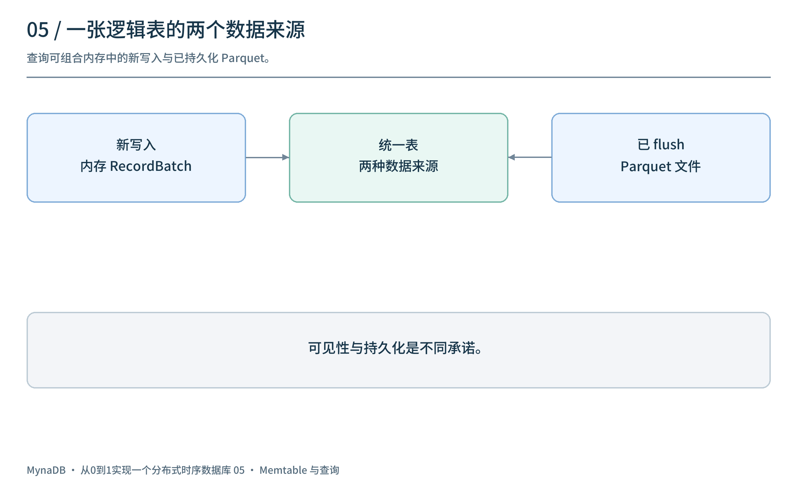
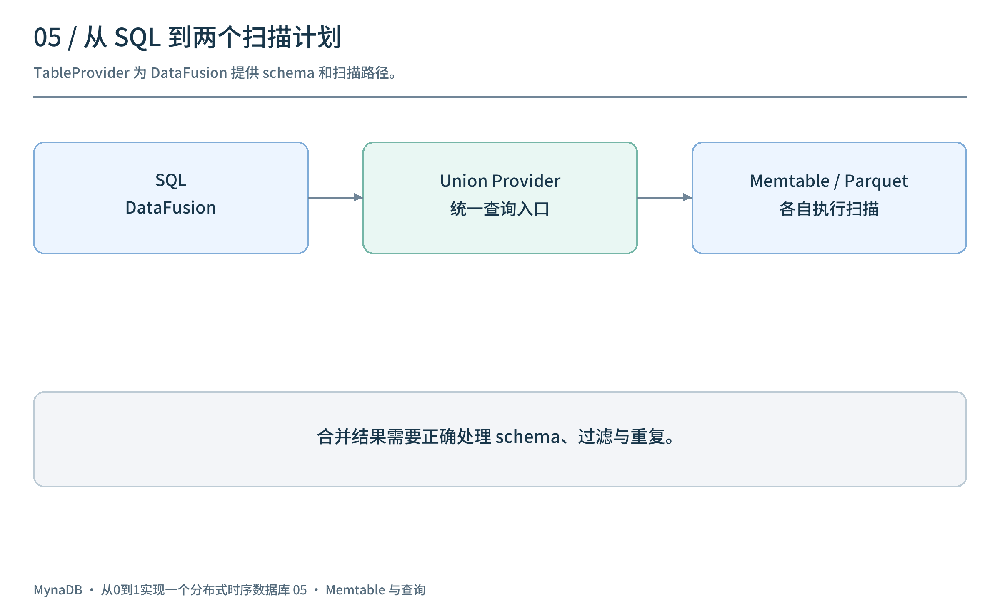
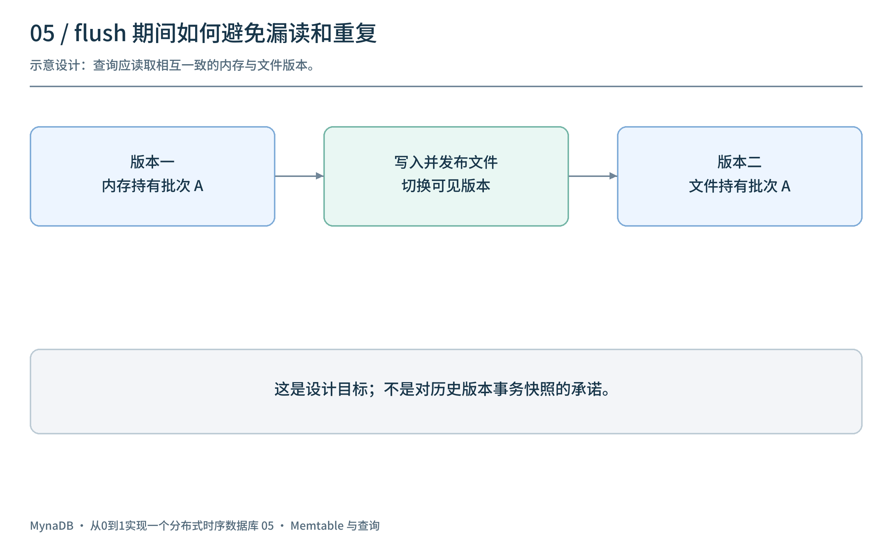
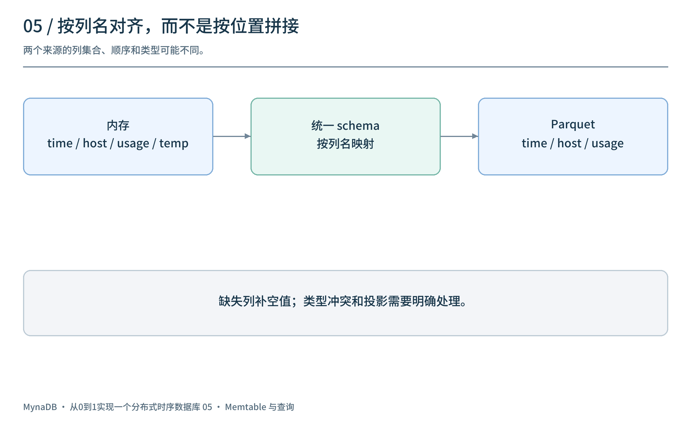
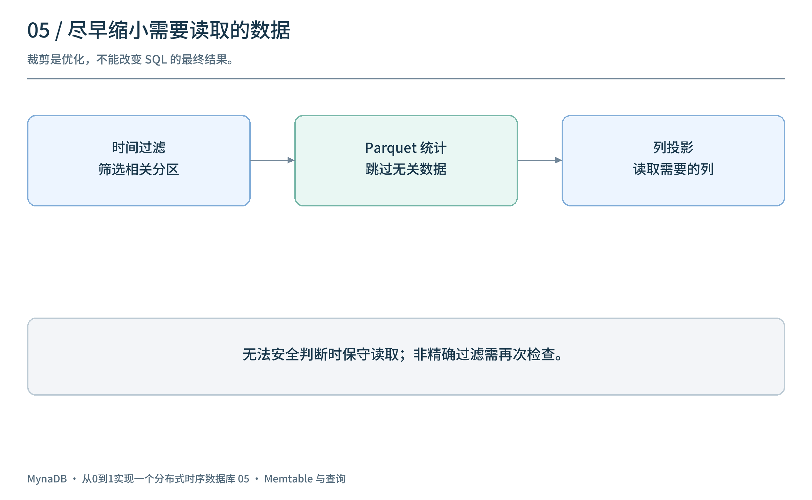
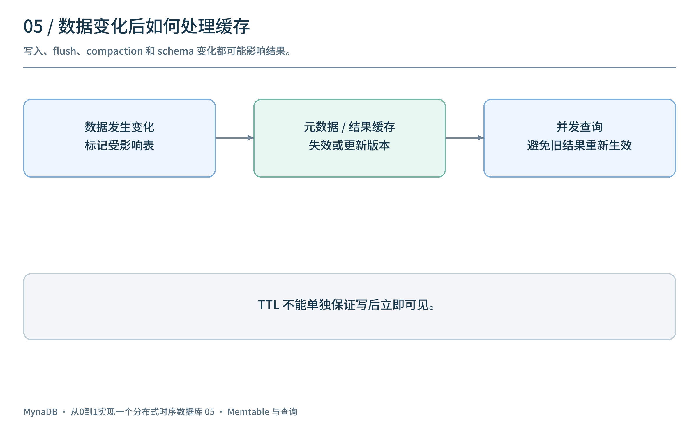

# 从0到1实现一个分布式时序数据库（五）：让新写入立即可查

[上一篇](../04-object-storage/article.md)把数据从内存批量写入 Parquet。如果查询只读取已持久化文件，一条刚写入的数据就要等到 flush 后才可见。对监控系统而言，这段等待可能让用户误以为最新指标没有到达。

这一篇以 `v0.4.0` / M5 为线索，讨论如何让 DataFusion 同时读取内存与 Parquet，以及这样做带来的 schema、并发和缓存问题。涉及快照与提交的部分是设计检查项，不表示该历史版本已经提供相应的完整一致性保证。

## 1. 两份数据，一张逻辑表

最近写入的点先进入内存；较早的数据已经保存在 Parquet。用户不应该为了查询一张表，分别写两次 SQL 再自己拼接结果。



```text
新写入 → 内存 RecordBatch ─┐
                          ├→ 统一的表 → DataFusion SQL
已 flush → Parquet 文件 ───┘
```

`v0.4.0` 引入了内存数据的查询路径，并提供 Memtable、Parquet 和 Union 相关 TableProvider，使查询能够组合新写入与文件数据。**可查询不等于已持久化**：内存可见性与 WAL、同步策略以及崩溃恢复承诺是不同问题。

## 2. TableProvider 如何连接 DataFusion？

DataFusion 在执行 SQL 时需要知道表的 schema，以及如何扫描表中的数据。TableProvider 是数据源与查询引擎之间的接口：引擎提出需要的列、过滤条件和执行计划，具体 provider 负责连接对应数据源。



在这一阶段：

- `MemtableProvider` 从写入缓存读取尚未 flush 的 RecordBatch。
- Parquet provider 负责已持久化数据的扫描。
- `UnionTableProvider` 将两条输入组合成统一的执行路径。

逻辑上的组合不等于自动去重，也不天然解决不同来源的 schema 不一致。列名、类型、列顺序、空值与过滤器语义都必须在两条路径上匹配。

## 3. Flush 正在发生时，怎样避免漏读和重复？

假设查询开始时，批次 A 正在从内存写入文件：

```text
内存中有 A  →  写出 A.parquet  →  发布文件  →  移除内存 A
```

如果查询在错误的时间分别读取内存和文件，可能**两边都没看到 A**，也可能**两边都看到 A**。简单地把两个数据源做 union，并不能单独证明切换期间结果正确。



一种设计思路是让查询持有一致的数据版本：同一版本中，批次 A 要么由内存负责，要么由已提交文件负责。发布新版本前完成文件写入；旧查询仍持有旧版本所需的数据，直到它们结束。错误重试、缓存失效与文件回收也需要遵循同一边界。

这是**设计目标与验证清单**，不是说 `v0.4.0` 已经实现事务性快照或无重复保证。第二篇讨论的 WAL checkpoint 也属于教学设计；不能假定它与该标签的 flush 实现完全一致。

## 4. Schema 合并：同一列真的相同吗？

考虑两个批次：

```text
内存：time, host, usage, temperature
文件：time, host, usage
```

查询 `temperature` 时，旧文件缺少该列，需要按统一 schema 补空值。还要处理列顺序不同和同名字段类型冲突；不能仅按位置假定两个来源的第 3 列相同。



`v0.4.0` 的 union provider 包含合并 schema 的代码；历史实现中相同字段名使用第一侧的定义。**这不是对任意异构 schema 和类型转换都正确的保证**。投影下推时也需要把统一 schema 中的列映射到每个输入各自的位置。对缺列、重排、类型冲突和过滤器分别编写结果校验测试，比仅验证“不报错”更有价值。

## 5. 少读一些：过滤、投影和时间分桶

时序查询常只关心某个时间范围和少量列：

```sql
SELECT host, AVG(usage)
FROM cpu
WHERE time >= TIMESTAMP '2026-01-01 00:00:00'
  AND time < TIMESTAMP '2026-01-02 00:00:00'
GROUP BY host;
```



可以利用时间分区和 Parquet 统计信息跳过不相关的数据，投影只需要的列，再执行过滤与聚合。过滤下推有精确和非精确的区别：当下层只能粗略筛选时，上层仍要重新应用过滤条件，确保结果正确。统计信息缺失或不能安全判断时，应保守读取。

该里程碑还加入时间分桶、填充以及 `first()` / `last()` 等时序分析相关能力。它们的具体语法、空桶行为和边界应按实现及测试确认；这里不把早期时间分组转换等同于后来加入的完整 InfluxQL 解析器。

## 6. 缓存加速，失效决定正确性

查询结果、表元数据和热点分区可以缓存，但新写入、flush、compaction 或 schema 变化都可能让旧缓存不再适用。



除了 TTL，更稳妥的设计需要明确：按什么粒度标记受影响的表或分区、如何关联数据版本，以及并发查询在失效后完成时能否重新放回过期结果。历史代码包含表级缓存失效入口，但它的存在不等于所有并发窗口均已验证；热点分区缓存后来还经历了正确性修复。

| 建议测试 | 核对什么 |
| --- | --- |
| 写入后立即查询 | 新数据在预期的可见性边界内出现 |
| 查询与 flush 交错 | 数据不遗漏、不重复，跨来源列对齐 |
| 新增字段与类型冲突 | 缺列、空值、列顺序及错误行为 |
| 查询缓存与并发写入 | 旧结果不在失效后错误地重新生效 |
| 重启与 WAL 恢复 | 可见性与持久化承诺分别符合配置 |

这些是建议验证的场景，并非本文已经运行的测试结果。

## 7. 回看这一阶段

Memtable 和 Parquet 的组合让一张逻辑表覆盖新旧数据；TableProvider 把数据源接到 DataFusion；缓存与裁剪减少重复工作。真正困难的部分在于**何时可见、两边如何对齐、数据切换时如何避免遗漏与重复**。

这一阶段仍以单机为主。下一篇将进入 `v0.5.0`：当多个节点共同处理写入和查询时，Router、Data、Meta 与 Raft 分别负责什么。

项目源码：[panbooks/mynadb](https://github.com/panbooks/mynadb) · [v0.4.0 源码](https://github.com/panbooks/mynadb/tree/v0.4.0) · [中文文档](https://panbooks.github.io/mynadb-portal/zh/index.html)。
