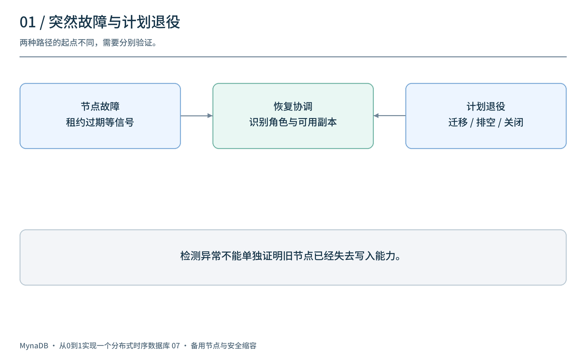
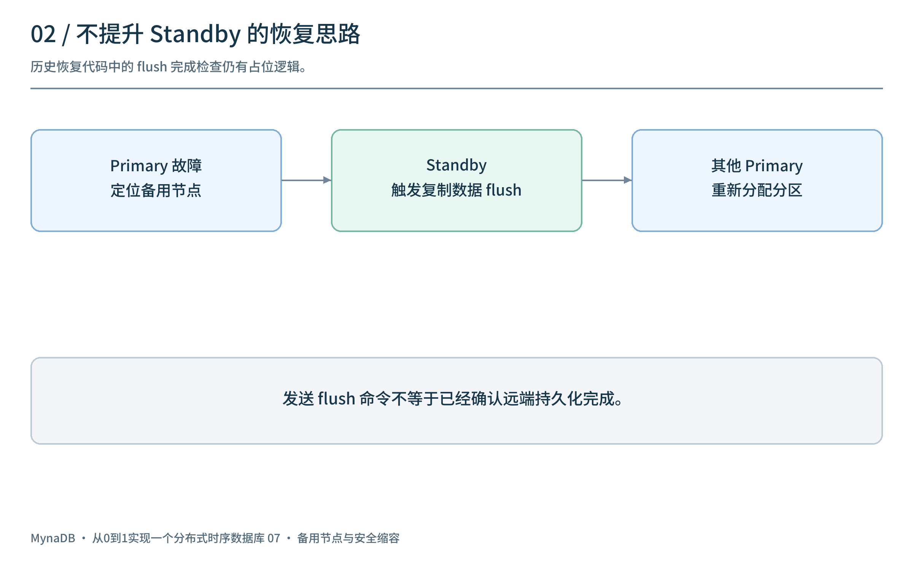
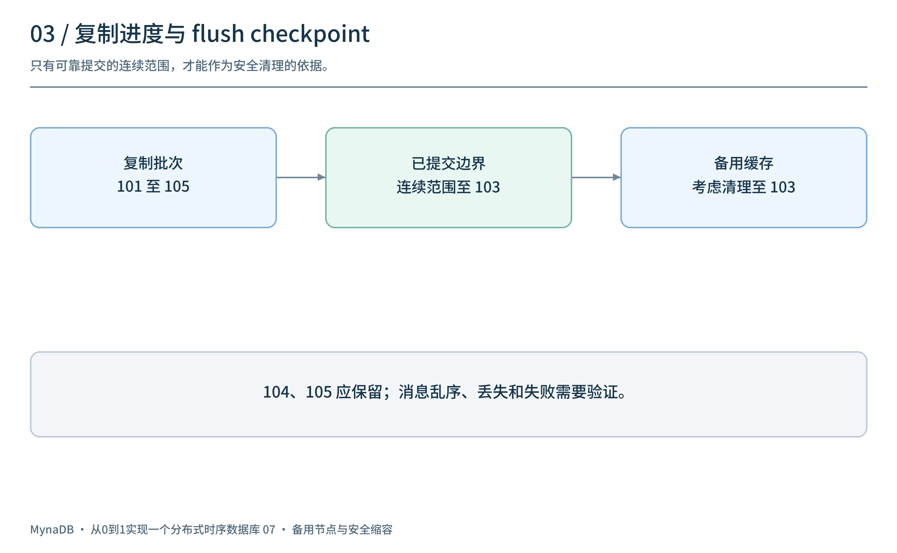
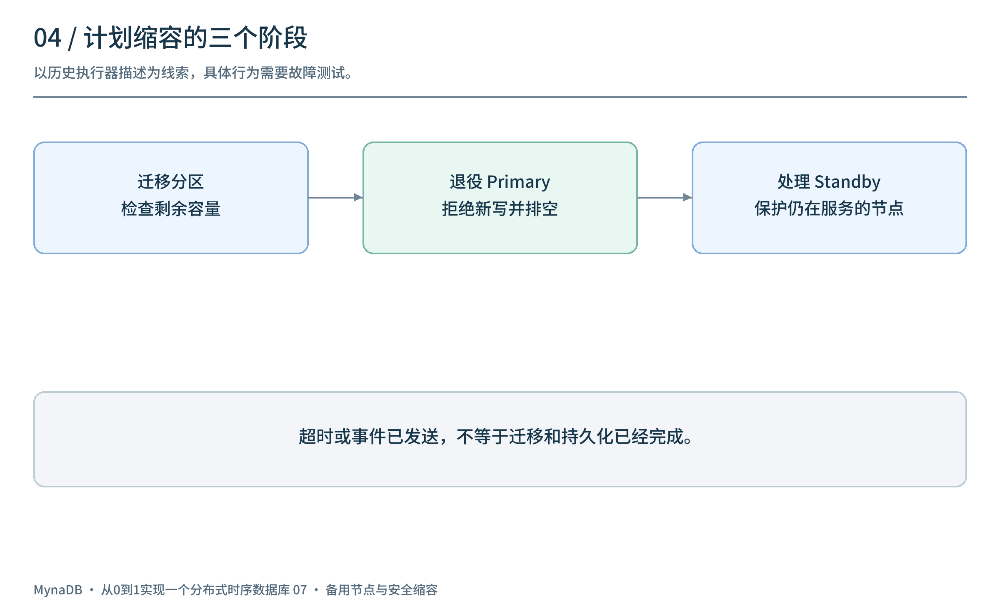
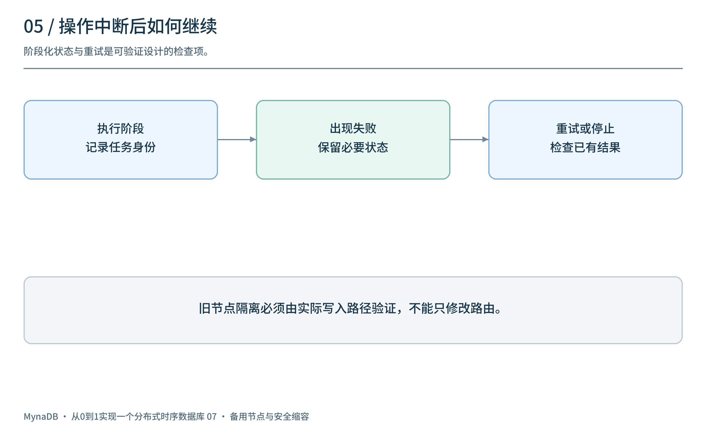
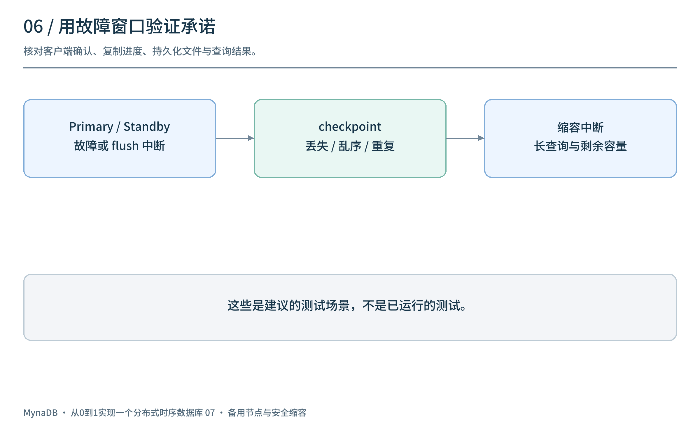

# 从0到1实现一个分布式时序数据库（七）：不提升 Standby 的恢复与安全缩容

[上一篇](../06-distributed-cluster/article.md)将系统拆成 Router、Data 和 Meta。节点运行时，写入会进入 Primary 的内存和存储路径，也可能复制到 Standby；但当一台节点突然退出，或者运维主动减少节点时，数据与请求该如何交接？

这一篇以 `v0.6.0` / M7 为线索，讨论**不将 Standby 提升为 Primary**的恢复设计，以及节点退役和缩容中的边界。流程图用于解释设计；具体历史实现仍有占位和限制，不代表已经验证无损恢复。

## 1. 两种情况：突然故障与计划退役

计划退役可以提前停止接收新任务、等待在途请求和处理内存数据；故障则可能发生在任意时刻，系统只能根据最后可靠保存的信息恢复。



| 情况 | 触发方式 | 关键问题 |
| --- | --- | --- |
| Primary 故障 | 租约过期等信号触发恢复流程 | Standby 实际收到哪些数据？分区如何重新分配？ |
| Standby 故障 | 检测到备用节点不可用 | 哪些 Primary 不再受到备用节点保护？ |
| 计划缩容 | 管理操作发起节点退役 | 如何迁移职责、排空内存并处理在途请求？ |

心跳或租约过期仍只是协调系统中的状态依据；要防止旧节点恢复后继续接受不该接受的写入，还需要完整的授权和隔离机制。

## 2. 不提升 Standby：保留角色，重新分配工作

早期常见的思路是把备用节点提升为新主。M7 的设计转向另一条路径：Primary 故障后，协调器找到为其保存复制数据的 Standby，触发相关数据 flush，再将分区分配给其他仍可用的 Primary。Standby 本身不因此改变为 Primary。



```text
Primary A 故障 → 找到 Standby S → 触发 S 处理 A 的复制数据
                                  ↓
                        分区重新分配给其他 Primary
```

这种分工让“谁保存备用数据”和“谁继续承担主写入职责”成为两个独立问题。它同样需要回答：备用数据是否完整？flush 的文件何时可见？旧 Primary 的写入权何时失效？没有其他 Primary 或 Standby 不可用时如何报告失败？

**历史实现的重要限制：** `v0.6.0` 的恢复管理器发出 Standby flush 命令后，完成等待处仍是短暂等待并假定完成，源码标有后续实现状态跟踪的 TODO。因此不能说该标签已经严格确认了 flush 完成，更不能据此承诺无损切换。

## 3. Flush checkpoint：备用缓存何时可以清理？

Standby 接收复制批次后，如果 Primary 已经将对应数据可靠写入持久化存储，备用缓存就不需要无限增长。一个思路是由 Primary 在成功 flush 后发送 checkpoint，告诉 Standby 某个连续序号范围已经完成。



例如：

```text
已复制：101 102 103 104 105
确认已 flush 的连续边界：103
可考虑清理：≤ 103；保留：104、105
```

`v0.6.0` 定义了 `FlushCheckpoint`，包含来源节点、可选分区和 `flushed_seq` 等信息。安全清理还要验证：checkpoint 是否对应实际成功提交的数据、分区与任期是否正确、重复和乱序消息如何处理，以及恢复流程是否仍依赖这些缓存。收到一个较大数字本身不能证明之前所有数据都已持久化。

图中的“连续提交边界”是安全设计要求，不能直接推断历史标签已覆盖所有竞争和失败窗口。异步复制下，Primary 确认给客户端但尚未到达 Standby 的数据，也不能靠备用缓存凭空恢复。

## 4. 计划缩容：先迁移，再退役

缩容不应等同于直接停止一个进程。一个需要验证的流程是：检查目标和剩余容量，迁移或重新分配职责，让退役节点拒绝新的写入，处理已有内存数据和在途查询，最后完成注销与关闭。



`v0.6.0` 的缩容执行器描述了三个阶段：**迁移分区 → 退役已清空的 Primary → 退役不再需要的 Standby**。执行前和执行过程中还需要检查备用节点等安全条件。节点侧代码包含退役标志、内存数据和在途查询数量的检查。

在这个过程中必须区分“开始退役”和“安全完成”：

- 新请求是否已经路由到其他节点，旧节点是否拒绝不再拥有权限的写入？
- 仍在执行的查询如何完成、取消或重试？
- flush 失败或超时后，能否继续删除节点元数据？
- 退役过程重试是否会重复迁移、遗漏分区或过早清理副本？

这些是检查流程闭环所需的问题，不是对历史代码所有路径的正确性认证。超时不应被自动解释为数据已经安全迁移。

## 5. 出错时先保护状态，再决定是否继续

恢复和缩容不是一串永远成功的步骤。对象存储写入失败、Standby 失联、Meta 状态变化或进程重启，都可能让任务停在中间。



一种可验证的操作设计应记录阶段和任务身份；每次重试先检查已有结果，再根据条件决定继续、停止或人工介入。对外报告应区分“请求已提交”“操作仍在执行”“验证完成”和“失败”，不能把事件已经发送当成远端工作已经完成。

如果涉及旧节点隔离，租约、任期或 fencing 必须在实际写入路径上被验证；仅修改路由缓存或节点状态，并不能阻止仍可访问存储的旧进程写入。这些是系统设计要求，而非本文对该版本实现作出的保证。

## 6. 如何验证恢复与缩容？



| 故障窗口 | 建议检查 |
| --- | --- |
| Primary 确认写入后立即退出 | 核对确认策略、Standby 实际收到的序号及可能损失 |
| Standby flush 请求发出后中断 | 是否真正完成；重复请求和重启后如何恢复 |
| checkpoint 丢失、重复或乱序 | 是否错误清理尚未持久化的数据 |
| 分区迁移中旧节点仍在服务 | 路由、授权和重复写入如何处理 |
| 退役时存在长查询 | 是否等待、取消或重试，结果是否完整 |
| 剩余 Primary 或备用节点不足 | 是否停止操作并清晰报告未受保护状态 |

测试中为写入设置稳定标识，记录客户端确认、节点状态、复制进度、文件及查询结果。进程终止、网络分区和存储失败应分别覆盖。上述表格是建议的验证计划，不是已经运行的结果。

## 7. 回看这一阶段

M7 将重点从“能否组建集群”转向“节点消失或退役时如何继续”：Standby 保留复制数据、恢复协调器重新分配工作、缩容流程尝试有序排空。**不提升 Standby 并不会自动带来无损或安全切换**；这些承诺仍取决于复制确认、flush 完成、授权隔离与故障验证。

下一篇进入 `v0.7.0`：当表和物理分区分布在不同节点上，如何分别维护表所有权与查询路由。

项目源码：[panbooks/mynadb](https://github.com/panbooks/mynadb) · [v0.6.0 源码](https://github.com/panbooks/mynadb/tree/v0.6.0) · [中文文档](https://panbooks.github.io/mynadb-portal/zh/index.html)。
